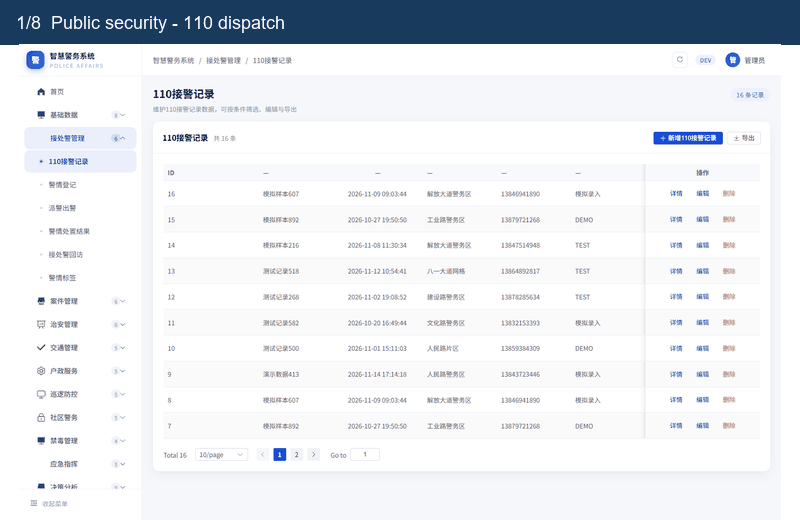
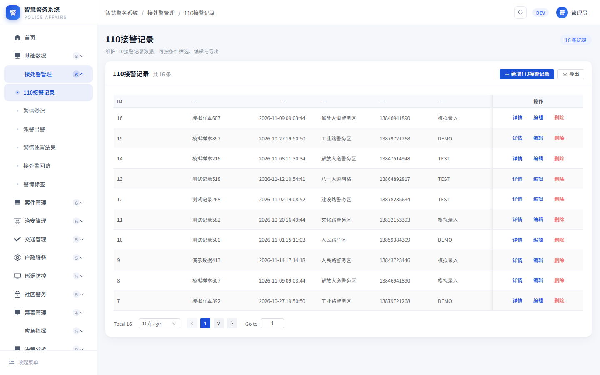
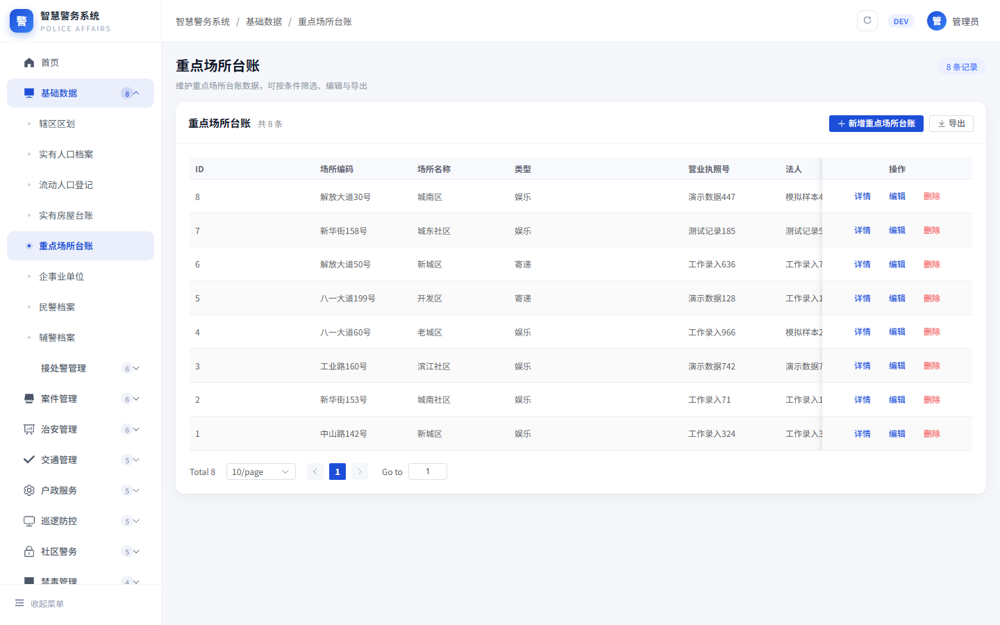
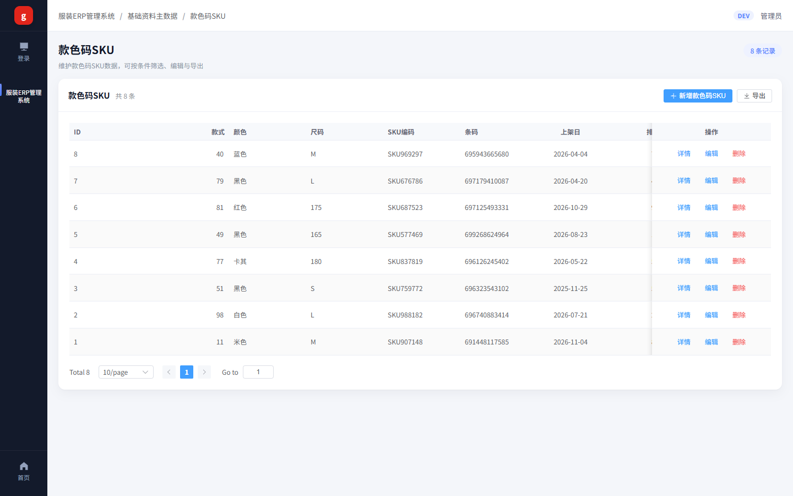
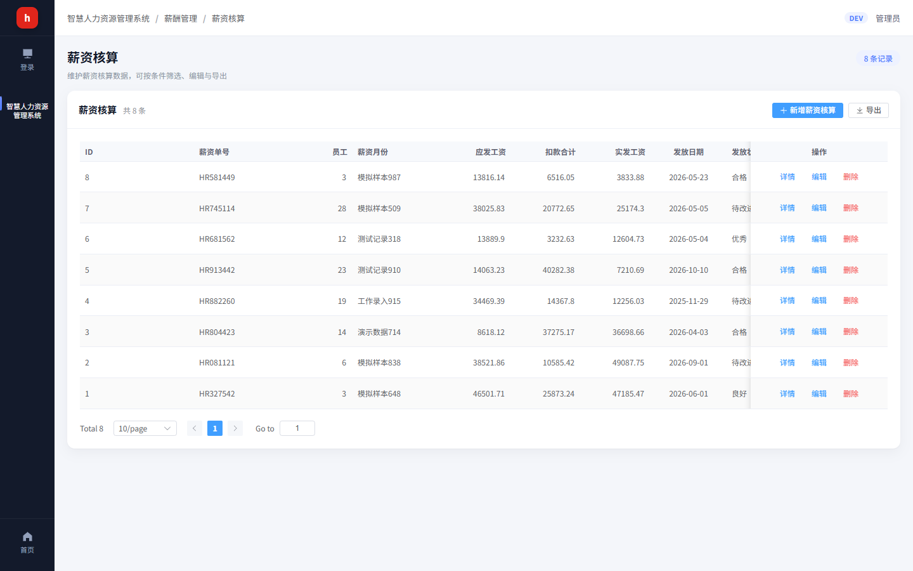
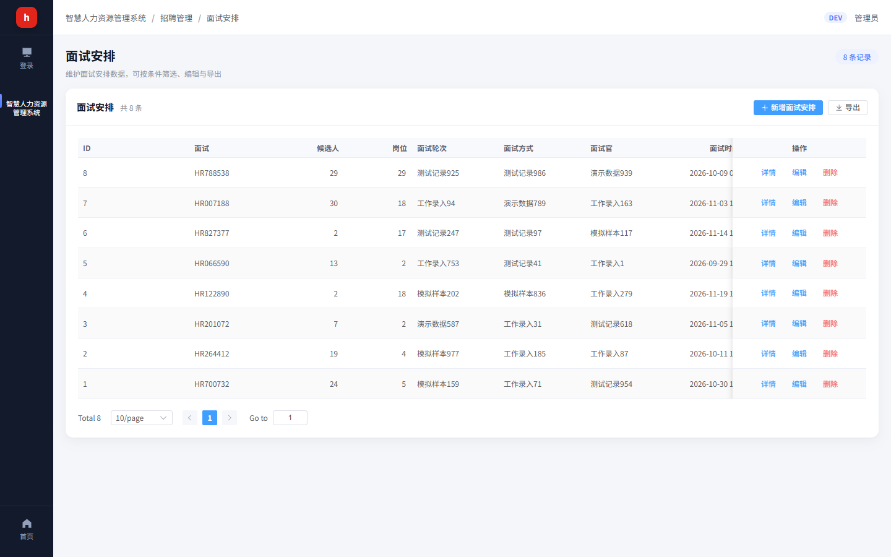
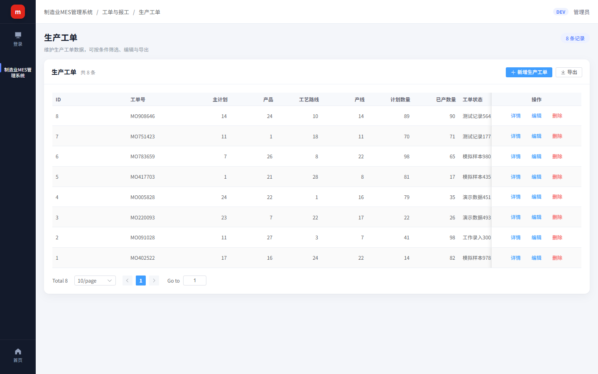
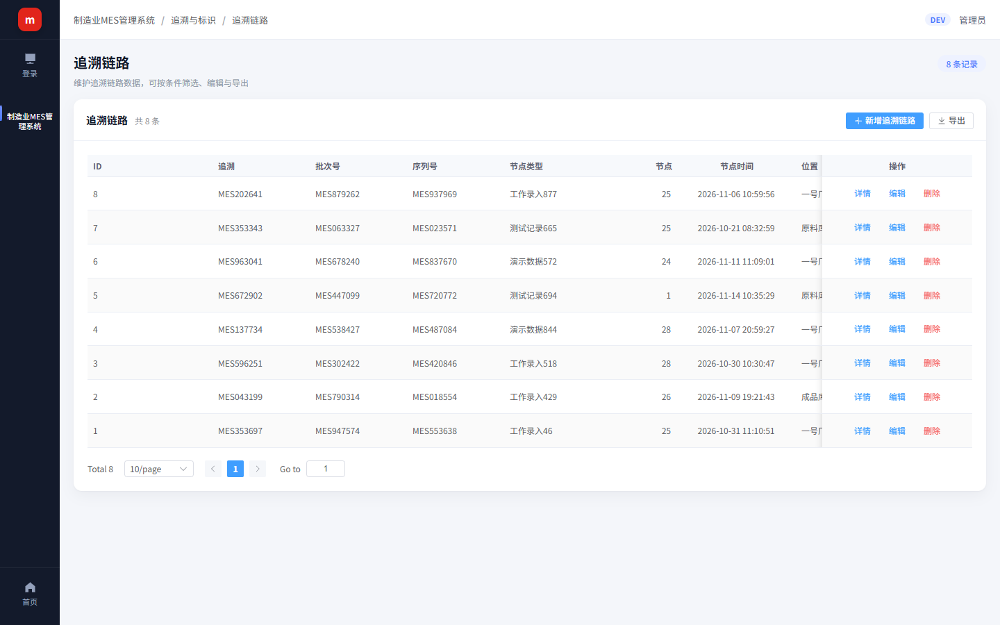

# Majiang CodeGen — DDL to Running Spring Boot + Vue System

**[Live Demo](https://hustxia.github.io/CodeGen/)** · **[GitHub](https://github.com/hustxia/CodeGen)** · **[简体中文](README_ZH.md)**

> **Help shape the Roadmap:** [which industry system should we generate next?](https://github.com/hustxia/CodeGen/issues/7) — leave a comment, every scenario goes into the candidate pool.

[](https://github.com/hustxia/CodeGen/releases) [](https://github.com/hustxia/CodeGen/actions/workflows/verify.yml) [](https://github.com/hustxia/CodeGen/actions/workflows/i18n-contract.yml) [](https://github.com/hustxia/CodeGen/actions/workflows/verify.yml) [](LICENSE)

---

> **From DDL to a running system — real screenshots, no mockups.**
> Import your database schema, one click generates compilable Spring Boot + Vue3 full-stack code
> with menus, permissions and i18n. Zero front/back drift.

[](docs/images/showcase/demo.gif)

---

## 60-Second Start

```bash
# 1. Create DB & seed
mysql -uroot -p -e "CREATE DATABASE gen_platform DEFAULT CHARSET utf8mb4;"
mysql -uroot -p gen_platform < docs/sql/V1.0__init.sql

# 2. Run backend
cp src/main/resources/application-local.yml.example src/main/resources/application-local.yml
mvn package -DskipTests && java -jar target/codegen-server.jar

# 3. Run frontend
cd ../codegen-web && npm install && npm run serve
# Open http://localhost:9530  →  admin / admin123
```

---

## What Makes CodeGen Different

| Dimension | Traditional Generator | Low-code Platform | CodeGen |
|---|---|---|---|
| Input | One-table config | Drag-and-drop | **DDL / live DB** |
| Front/back drift | Manual fix | Locked in | **Same metadata → zero drift** |
| Compile self-check | Rare | Platform-internal | **Real `javac` self-check** |
| Merge with existing | Overwrite risk | Locked in | **Marker-block + three-way merge** |
| Rollback | None | Snapshot | **Four-state ledger + one-click** |
| i18n | Separate work | Partial | **206-lang framework, 12 professionally translated** |
| Deliverable | Snippets | Platform app | **Compilable, runnable full project** |

**Jump to:** [Showcase](#showcase) · [Quick Start](#10-quick-start) · [Latest updates](#12-latest-updates) · [Releases](https://github.com/hustxia/CodeGen/releases)

---

> **Language support**: the framework covers **206 languages**; **12 are professionally translated** (zh-CN, en-US, ja-JP, ko-KR, fr-FR, de-DE, es-ES, ar-SA, ru-RU, pt-BR, id-ID, vi-VN). Generated pages fall back gracefully when a language is not translated. Want to contribute? See [`多语言项目介绍/CONTRIBUTING.md`](多语言项目介绍/CONTRIBUTING.md).

<a id="showcase"></a>

## Showcase · Systems Built with CodeGen

> Real, runnable systems generated end-to-end by this generator — from database tables to front-end pages, menus and permissions. Not mockups: every list below is backed by live data. Click any image to view full size.

**Public security · 64 pages / 79 tables** — one-sentence build from a functional design doc, with district data, police-calling records and key-place ledgers.

| 110 dispatch & incident registration | Key-place register |
| :---: | :---: |
| [](docs/images/showcase/police-110-dispatch.png) | [](docs/images/showcase/police-key-places.png) |

**Apparel ERP · 71 pages** — style/color/size matrix, BOM, dye-lot traceability and sell-through analytics.

| Style-color-size SKU | Sell-through & replenishment analytics |
| :---: | :---: |
| [](docs/images/showcase/garment-sku.png) | [](docs/images/showcase/garment-sellthrough.png) |

**Smart HR · 68 pages** — organization, recruiting, attendance, payroll and performance across 14 HR domains.

| Payroll calculation | Interview scheduling |
| :---: | :---: |
| [](docs/images/showcase/hr-payroll.png) | [](docs/images/showcase/hr-interview.png) |

**Manufacturing MES · 68 pages** — work orders, quality gates, equipment, batch/serial traceability and Andon.

| Production work order | Batch traceability chain |
| :---: | :---: |
| [](docs/images/showcase/mes-work-order.png) | [](docs/images/showcase/mes-traceability.png) |

> Each system went through the same 12-step pipeline: DDL preview → build database → generate → seed data → full-page verification (zero empty lists, zero page errors). See the CSDN walkthroughs in `docs/blog/`.

---

## 1. What Is This

CodeGen is a "table-driven" code factory. Bring in your business tables (via database import or by pasting DDL), configure fields and generation switches, then click "Generate" — it produces the backend Entity/Mapper/Service/Controller/DTO/VO, the frontend `api.js` and Vue pages, menus and routes, even A4 print pages and integration-test skeletons, and safely writes them into your target project.

It doesn't just "spit out code" — it is a **delivery pipeline with quality gates and rollback capability**:

```
Table intake (DB import / DDL)
   → Field & switch configuration (with AI recommendations)
      → One-click generation: self-check → backup → write to disk → compile/validate → register menu → rebuild routes
         → Ledger bookkeeping → rollback-capable
```

---

## 2. Who Are the Users, and How They Use It

| Users | Typical Needs | Path the Platform Provides |
| --- | --- | --- |
| Backend developer | Has a batch of tables (or DDL) and wants to quickly spin up CRUD | Table config page: import → configure fields → one-click generation |
| Full-stack / solo developer | Wants to build a complete system from scratch (with login, permissions, dictionaries) | Pipeline page: build a system with one sentence |
| Team lead | Wants to unify code style, coding standards, directory structure | System management: one system = one output config, applied in batch |
| Platform maintainer | Wants to change templates without changing code | Template management: online editing, takes effect on save, supports history rollback |
## 3. What Problems It Solves

| Pain point | What CodeGen does |
| --- | --- |
| Repetitive CRUD hell — a pile of boilerplate for every table | Per-table switches produce a complete front & back end in one click, including CRUD, pagination, validation, import/export |
| Front/back field & API mismatches causing endless integration fixes | The same table metadata drives both backend APIs and frontend pages — zero semantic drift |
| Team conventions hard to unify; everyone's style differs | Templates are the convention: 22 FreeMarker templates centrally managed, editable online with version rollback |
| Generators "overwrite and lose" hand-written logic | Marker-block merge mechanism: hand-written code is preserved, only generated regions are replaced |
| Generated code untrustworthy until compile time | In-memory compile self-check (real `javac`), structural contract checks, on-disk diff preview — nothing lands on disk unless it compiles |
| Scaffolding a new system from zero is time-consuming | Pipeline "build a system with one sentence": create DB → scaffold → generate → package → register menus, fully automated |

---

## 4. Capability Landscape

- **Table intake**: DDL parsing, direct database import, batch intake wizard, auto-derived column configuration (controls / validation / dictionaries / relations).
- **Table shapes**: single table, tree table (tree API + tree grid), master-detail (same-transaction save + detail tabs), many-to-many junction tables.
- **Generated artifacts**: Entity / Mapper / Service / Controller / DTO / VO + `api.js` + Vue pages + A4 print pages + integration-test skeletons.
- **Business enhancements**: relation dropdowns, dictionary translation, data masking, uniqueness checks, form linkage, data-scope permissions, Excel import/export, approval workflow, payment / file / mobile capability packs, and the V9.15 data-visualization chart pack (`chart_enabled` tri-state switch; pie/line/bar/gauge inferred purely from column metadata with zero domain keywords; per-table `/{module}/stats` endpoints with generation-time field whitelist; ECharts cards + cross-table dashboard whose series colors follow `--app-primary`; chart-off output byte-identical).
- **Quality gates**: in-memory compile self-check (real `javac`), structural contract checks, permission-consistency checks, on-disk diff preview, real validation of frontend artifacts.
- **Safe landing**: write to disk + `.gen-backup` batch backups, marker-block merging to preserve hand-written code, `gen_output` four-state ledger (created / merged / skipped / failed), historical rollback.
- **Multi-system isolation**: each target project is a "system configuration" (front/back paths, package names, gateway prefix, dependency classpath, generation-switch defaults) — multiple projects served in parallel.
- **AI enhancements**: build a system with one sentence (AI modeling), seed-data AI enhancement, per-table AI recommended configuration (diff preview + checked apply).

---

## 5. Typical Scenarios

| Scenario | Description |
| --- | --- |
| Tree table | Hierarchical data such as product categories — auto-produced tree API, tree grid and parent-selection dropdown |
| Single-table CRUD | Customers, products, etc. — FK dropdowns + dictionary translation + import/export out of the box |
| Master-detail | Sales orders + order items — same-transaction save, detail drawer with dual tabs (master info / details) |
| Read-only / stats | Inventory flows, etc. — write switches off, query and export only |
| Print documents | Tick the "print" switch to produce an A4 print page and route, with header + detail table |
| One-sentence system build | Describe the business domain — AI creates DB & tables + scaffold + full generation + menu registration in one go |

> All scenarios have runnable demos (`demo_admin` project) with screenshots — see `docs/典型场景操作指南-演示后台demo.md` (Chinese).

---

## 6. Core Workflow

```
┌─────────────┐   ┌───────────────────┐   ┌──────────────────────────────────────────────────┐
│ Table intake │ → │ Field/switch conf. │ → │ One-click generate (self-check→backup→write→     │ → │ Ledger · Rollback │
│              │   │                    │   │ compile→menu→route)                              │   │                   │
└─────────────┘   └───────────────────┘   └──────────────────────────────────────────────────┘
  DB import/DDL     controls/validation     Lands on disk only after all quality gates pass;      Batch-level traceability
                    /dictionaries           hand-written code is preserved
```

- **Diff preview**: generated artifacts are diffed file-by-file against the current disk state; you confirm before anything is written, avoiding accidental overwrites.
- **Generation ledger**: every file records its action, byte count, MD5 and backup location; a whole batch can be rolled back.

---

## 7. Build a System with One Sentence (Pipeline)

A high-level capability aimed at "scaffolding a backend from scratch". After you describe the business domain, the pipeline advances automatically through 5 stages:

| Stage | Meaning |
| --- | --- |
| `CHECK` | Validate target project configuration and dependency classpath |
| `WRITE` | Create database & tables, write scaffold and generated artifacts |
| `COMPILE` | Backend `mvn package` / frontend build, in-memory compile self-check |
| `MENU` | Produce and register menu permissions (dual outlets: artifact SQL / internal direct write) |
| `ROUTE` | Rebuild frontend route fragments |

Any stage failure aborts immediately with a readable error for easy locating.

---

## 8. System Architecture

Front-end and back-end separated, two repositories working together:

| Repository | Role | Stack |
| --- | --- | --- |
| `codegen-server` | Backend: generation engine, templates, validation, ledger, pipeline | Java 21 · Spring Boot 3.2.5 · MyBatis-Plus 3.5.5 · FreeMarker · JWT · MySQL 8 · springdoc-openapi |
| `codegen-web` | Frontend: console (table config / templates / ledger / system management) | Vue 2.7 · Element UI (platform console only; generated projects use Vue 3 + Element Plus + Vite) · axios · Vue Router (history mode) |

Backend layering:

```
controller/    API layer (Gen* generation chain / Sys* system management / pipeline)
service/impl/  Core implementations (generation chain, template engine, merge, validation, pipeline execution)
util/          Template engine, model assembly, marker-block merge, self-check compilation
config/        Output config, self-check config, template seeder
common/        Result / BaseEntity / exceptions / audit
resources/gen-templates/   22 FreeMarker templates (backend / frontend / shared / test groups)
```

**Foundation capabilities the target project must provide** (the generator only produces business code; a missing foundation fails silently):

1. MyBatis-Plus pagination plugin (`PaginationInnerInterceptor`)
2. Foundation classes such as `Result` / `BaseEntity` / `PageQuery` (package prefix must match `root-package`)
3. Frontend `utils/request.js` with `toPageData` (converts `Page{records,total}` into `{list,total}`)
4. Dependencies `springdoc-openapi-starter-webmvc-ui` (generated code uses `@Operation`) and `poi-ooxml` (Excel)

---

## 9. Tech Stack at a Glance

| Dimension | Choice |
| --- | --- |
| Backend language / framework | Java 21 / Spring Boot 3.2.5 |
| Persistence | MyBatis-Plus 3.5.5 |
| Template engine | FreeMarker (22 seed templates, online editing + version rollback) |
| Security | JWT authentication |
| Database | MySQL 8 |
| Frontend (generated projects) | Vue 3 + Element Plus + Vite |
| Frontend (platform console) | Vue 2.7 + Element UI |
| Local AI | qwen2.5-coder:7b (modeling / recommended config / seed-data enhancement) |
| API docs | springdoc-openapi (Swagger UI) |

> **Two frontends, two stacks.** Since V9.0 the **generated projects** target **Vue 3 + Element Plus + Vite** (Vue 3.4 / Element Plus 2.7 / Vue Router 4 / Vuex 4 / Vite 5). The platform console `codegen-web` remains Vue 2.7 + Element UI + Vue CLI 5 and was not part of that upgrade. Do not read the console `package.json` as the generated project dependency list.

---

## 10. Quick Start

### 1. Create the database (13 platform tables + default account admin/admin123)

```bash
mysql -uroot -p -e "CREATE DATABASE gen_platform DEFAULT CHARSET utf8mb4;"
mysql -uroot -p gen_platform < docs/sql/V1.0__init.sql
```

### 2. Configure the target project

Copy the config template and adjust to your local paths:

```bash
cp src/main/resources/application-local.yml.example src/main/resources/application-local.yml
```

`application-local.yml` is excluded by `.gitignore` and will not be committed. Key settings:

```yaml
gen:
  output:
    backend-root: /path/to/your-target-project      # write-to-disk base for artifacts
    frontend-root: /path/to/your-target-project
    frontend-path: demo-web                          # frontend subdirectory for monorepos
    backend-path: demo-server/src/main/java/com/demo
    package-name: com.demo
    root-package: com.demo                           # prefix for foundation-class imports in artifacts
  selfcheck:
    classpath: /path/to/your-target-project/demo-lib/*
```

Export the self-check dependency directory like this:

```bash
cd your-target/demo-server
mvn dependency:copy-dependencies -DoutputDirectory=../demo-lib
```

### 3. Start the backend

```bash
mvn package -DskipTests
java -jar target/codegen-server.jar
```

The service defaults to port **8120**; API docs at `/swagger-ui/index.html`.

### 4. Start the frontend

```bash
cd ../codegen-web
npm install
npm run serve
```

The frontend defaults to port **9530**, proxying `/dev-api` to backend port 8120. Default account `admin / admin123`.

### 5. Key configuration items

| Setting | Description |
| --- | --- |
| `gen.output.*` | Artifact write paths, package names, module mapping |
| `gen.selfcheck.classpath` | Dependency classpath for in-memory compile self-check, supports `dir/*` |
| `gen.menu.outlet` | `artifact` produces menu SQL & route fragments only; `internal` also writes the platform's own `sys_menu` |

---

## 12. Latest updates

| Version | What changed |
| --- | --- |
| **V9.27** | Menu regrouping and admin UI polish: system monitor / test center / verification hub under System Management, MCP under Projects & Data, three-level flyout navigation, theme switch restored, full menu audit (28 leaves / 5 groups). Includes V9.26.1–V9.27.3 fixes. |
| **V9.26** | Menus regrouped by functional domain; industry paradigm pack 404 fixed with nested flyout routes. |
| **V9.25** | Guardrail clarification wizard and 28 industry rules (SDD artifact chain M2.1). |
| **V9.24** | Quality gates hardened: numeric-order SQL migration, idempotent column DDL, H2 schema coverage, template contract fixed — all 620 tests green. |
| **V9.23** | MCP Server: Java Streamable HTTP with five tools and call audit. |
| **V9.22** | Industry paradigm template market and install mechanism. |
| **V9.21** | SDD spec artifact chain and Converge reconciliation (M1.1). |
| **V9.20** | Eight capability-pack gaps closed: payment endpoints, print QR, security data scope, workflow designer, unique keys, demo speed. |
| **V9.19** | Modeling at scale: batched DDL creation, i18n coverage automation (12 languages), template market prototype. |
| **V9.18** | Generation quality: template impact preview, child_save_mode three-way merge, S8/S9 verification gates. |

## 14. Author & Support

- **Author**: a Chinese programmer (independent developer)
- **Repositories**: [GitHub](https://github.com/hustxia/CodeGen) · [Gitee](https://gitee.com/hustxiayuhong/CodeGen.git)
- **Email**: `hustxiayuhong@126.com`
- **Technical support**: please write your email **in Chinese**, including the problem description, runtime environment (JDK / MySQL / version) and reproduction steps

> I read and reply to every email. Bug reports, feature requests and collaboration inquiries are all welcome.

---
