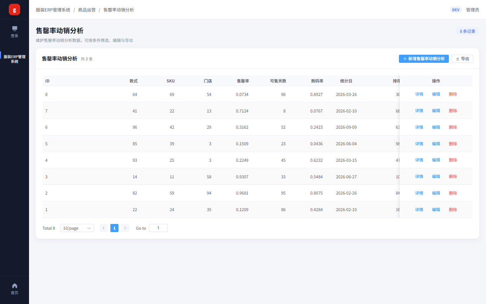

# Majiang · Code Generator (CodeGen) — Project Introduction

> Languages: [简体中文](README_ZH.md) · [繁體中文](README_ZH_TW.md) · **English** · [日本語](README_JA.md) · [한국어](README_KO.md) · [Türkçe](README_TR.md) · [Русский](README_RU.md) · [Tiếng Việt](README_VI.md) · [ไทย](README_TH.md) · [Deutsch](README_DE.md) · [Español](README_ES.md) · [Français](README_FR.md) · [Українська](README_UK.md) · [Polski](README_PL.md) · [Português (Brasil)](README_PT_BR.md) · [Português](README_PT.md) · [العربية](README_AR.md) · [فارسی](README_FA.md) · [Bahasa Indonesia](README_ID.md) · [Italiano](README_IT.md) · [Ελληνικά](README_EL.md) · [മലയാളം](README_ML.md) · [Roman Urdu](README_UR_ROMA.md) · [اردو](README_UR.md) · [Română](README_RO.md) · [Български](README_BG.md) · [हिन्दी](README_HI.md) · [বাংলা](README_BN.md) · [Nederlands](README_NL.md) · [Svenska](README_SV.md) · [Dansk](README_DA.md) · [Suomi](README_FI.md) · [Norsk](README_NO.md) · [Čeština](README_CS.md) · [Magyar](README_HU.md) · [Hrvatski](README_HR.md) · [Slovenčina](README_SK.md) · [Slovenščina](README_SL.md) · [Eesti](README_ET.md) · [עברית](README_HE.md) · [தமிழ்](README_TA.md) · [తెలుగు](README_TE.md) · [မြန်မာ](README_MY.md) · [ខ្មែរ](README_KM.md) · [Filipino](README_TL.md) · [Kiswahili](README_SW.md) · [Հայերեն](README_HY.md) · [ქართული](README_KA.md)

---

## At a glance

**CodeGen turns a database schema into a complete Spring Boot + Vue business system — code that compiles, runs, and ships with menus, permissions and i18n.**

- **Table-driven, not prompt-driven** — import DDL or connect your DB; one click generates Entity / Mapper / Service / Controller / DTO / VO, Vue pages, routes and menus from the same metadata, so front end and back end never drift apart.
- **Quality gates built in** — real `javac` self-check, structural contract checks, `.gen-backup` batch backups, marker-block merge that preserves hand-written code, and a four-state ledger with one-click rollback.
- **One-sentence system build** — a 12-step pipeline takes you from a plain-language description to a running system: create DB → scaffold → generate → seed data → register menus.
- **Proven across industries** — full systems generated end to end for public security, apparel ERP, HR and manufacturing MES (screenshots below); generated pages support 206 languages out of the box.

**Jump to:** [Showcase](#showcase) · [Quick Start](#10-quick-start) · [Documentation](#11-documentation-map) · [Contributing](CONTRIBUTING.md)

---

> **Language support**: generated systems ship with full-page internationalization built in. The framework supports switching and fallback across **206 languages**; **8 are professionally translated** (zh-CN, en-US, ja-JP, ko-KR, fr-FR, de-DE, es-ES, ar-SA), and all others fall back to Simplified Chinese. Want to contribute a translation? See [`多语言项目介绍/CONTRIBUTING.md`](多语言项目介绍/CONTRIBUTING.md).

> A multi-project code generator for **Spring Boot + Vue**: starting from database table structures, it produces **compilable, runnable, menu-and-permission-ready** front-end and back-end business code, and handles the full delivery loop of writing to disk, backup, ledgering and rollback.

GitHub: https://github.com/hustxia/CodeGen

<a id="showcase"></a>

## Showcase · Systems Built with CodeGen

> Real, runnable systems generated end-to-end by this generator — from database tables to front-end pages, menus and permissions. Not mockups: every list below is backed by live data. Click any image to view full size.

**Public security · 64 pages / 79 tables** — one-sentence build from a functional design doc, with district data, police-calling records and key-place ledgers.

| 110 dispatch & incident registration | Key-place register |
| :---: | :---: |
| [](docs/images/showcase/police-110-dispatch.png) | [](docs/images/showcase/police-key-places.png) |

**Apparel ERP · 71 pages** — style/color/size matrix, BOM, dye-lot traceability and sell-through analytics.

| Style-color-size SKU | Sell-through & replenishment analytics |
| :---: | :---: |
| [](docs/images/showcase/garment-sku.png) | [](docs/images/showcase/garment-sellthrough.png) |

**Smart HR · 68 pages** — organization, recruiting, attendance, payroll and performance across 14 HR domains.

| Payroll calculation | Interview scheduling |
| :---: | :---: |
| [](docs/images/showcase/hr-payroll.png) | [](docs/images/showcase/hr-interview.png) |

**Manufacturing MES · 68 pages** — work orders, quality gates, equipment, batch/serial traceability and Andon.

| Production work order | Batch traceability chain |
| :---: | :---: |
| [](docs/images/showcase/mes-work-order.png) | [](docs/images/showcase/mes-traceability.png) |

> Each system went through the same 12-step pipeline: DDL preview → build database → generate → seed data → full-page verification (zero empty lists, zero page errors). See the CSDN walkthroughs linked in [Documentation Map](#11-documentation-map).

---

## 1. What Is This

CodeGen is a "table-driven" code factory. Bring in your business tables (via database import or by pasting DDL), configure fields and generation switches, then click "Generate" — it produces the backend Entity/Mapper/Service/Controller/DTO/VO, the frontend `api.js` and Vue pages, menus and routes, even A4 print pages and integration-test skeletons, and safely writes them into your target project.

It doesn't just "spit out code" — it is a **delivery pipeline with quality gates and rollback capability**:

```
Table intake (DB import / DDL)
   → Field & switch configuration (with AI recommendations)
      → One-click generation: self-check → backup → write to disk → compile/validate → register menu → rebuild routes
         → Ledger bookkeeping → rollback-capable
```

---

## 2. Who Are the Users, and How They Use It

| Users | Typical Needs | Path the Platform Provides |
| --- | --- | --- |
| Backend developer | Has a batch of tables (or DDL) and wants to quickly spin up CRUD | Table config page: import → configure fields → one-click generation |
| Full-stack / solo developer | Wants to build a complete system from scratch (with login, permissions, dictionaries) | Pipeline page: build a system with one sentence |
| Team lead | Wants to unify code style, coding standards, directory structure | System management: one system = one output config, applied in batch |
| Platform maintainer | Wants to change templates without changing code | Template management: online editing, takes effect on save, supports history rollback |
## 3. What Problems It Solves

| Pain point | What CodeGen does |
| --- | --- |
| Repetitive CRUD hell — a pile of boilerplate for every table | Per-table switches produce a complete front & back end in one click, including CRUD, pagination, validation, import/export |
| Front/back field & API mismatches causing endless integration fixes | The same table metadata drives both backend APIs and frontend pages — zero semantic drift |
| Team conventions hard to unify; everyone's style differs | Templates are the convention: 22 FreeMarker templates centrally managed, editable online with version rollback |
| Generators "overwrite and lose" hand-written logic | Marker-block merge mechanism: hand-written code is preserved, only generated regions are replaced |
| Generated code untrustworthy until compile time | In-memory compile self-check (real `javac`), structural contract checks, on-disk diff preview — nothing lands on disk unless it compiles |
| Scaffolding a new system from zero is time-consuming | Pipeline "build a system with one sentence": create DB → scaffold → generate → package → register menus, fully automated |

---

## 4. Capability Landscape

- **Table intake**: DDL parsing, direct database import, batch intake wizard, auto-derived column configuration (controls / validation / dictionaries / relations).
- **Table shapes**: single table, tree table (tree API + tree grid), master-detail (same-transaction save + detail tabs), many-to-many junction tables.
- **Generated artifacts**: Entity / Mapper / Service / Controller / DTO / VO + `api.js` + Vue pages + A4 print pages + integration-test skeletons.
- **Business enhancements**: relation dropdowns, dictionary translation, data masking, uniqueness checks, form linkage, data-scope permissions, Excel import/export, approval workflow, payment / file / mobile capability packs.
- **Quality gates**: in-memory compile self-check (real `javac`), structural contract checks, permission-consistency checks, on-disk diff preview, real validation of frontend artifacts.
- **Safe landing**: write to disk + `.gen-backup` batch backups, marker-block merging to preserve hand-written code, `gen_output` four-state ledger (created / merged / skipped / failed), historical rollback.
- **Multi-system isolation**: each target project is a "system configuration" (front/back paths, package names, gateway prefix, dependency classpath, generation-switch defaults) — multiple projects served in parallel.
- **AI enhancements**: build a system with one sentence (AI modeling), seed-data AI enhancement, per-table AI recommended configuration (diff preview + checked apply).

---

## 5. Typical Scenarios

| Scenario | Description |
| --- | --- |
| Tree table | Hierarchical data such as product categories — auto-produced tree API, tree grid and parent-selection dropdown |
| Single-table CRUD | Customers, products, etc. — FK dropdowns + dictionary translation + import/export out of the box |
| Master-detail | Sales orders + order items — same-transaction save, detail drawer with dual tabs (master info / details) |
| Read-only / stats | Inventory flows, etc. — write switches off, query and export only |
| Print documents | Tick the "print" switch to produce an A4 print page and route, with header + detail table |
| One-sentence system build | Describe the business domain — AI creates DB & tables + scaffold + full generation + menu registration in one go |

> All scenarios have runnable demos (`demo_admin` project) with screenshots — see `docs/典型场景操作指南-演示后台demo.md` (Chinese).

---

## 6. Core Workflow

```
┌─────────────┐   ┌───────────────────┐   ┌──────────────────────────────────────────────────┐
│ Table intake │ → │ Field/switch conf. │ → │ One-click generate (self-check→backup→write→     │ → │ Ledger · Rollback │
│              │   │                    │   │ compile→menu→route)                              │   │                   │
└─────────────┘   └───────────────────┘   └──────────────────────────────────────────────────┘
  DB import/DDL     controls/validation     Lands on disk only after all quality gates pass;      Batch-level traceability
                    /dictionaries           hand-written code is preserved
```

- **Diff preview**: generated artifacts are diffed file-by-file against the current disk state; you confirm before anything is written, avoiding accidental overwrites.
- **Generation ledger**: every file records its action, byte count, MD5 and backup location; a whole batch can be rolled back.

---

## 7. Build a System with One Sentence (Pipeline)

A high-level capability aimed at "scaffolding a backend from scratch". After you describe the business domain, the pipeline advances automatically through 5 stages:

| Stage | Meaning |
| --- | --- |
| `CHECK` | Validate target project configuration and dependency classpath |
| `WRITE` | Create database & tables, write scaffold and generated artifacts |
| `COMPILE` | Backend `mvn package` / frontend build, in-memory compile self-check |
| `MENU` | Produce and register menu permissions (dual outlets: artifact SQL / internal direct write) |
| `ROUTE` | Rebuild frontend route fragments |

Any stage failure aborts immediately with a readable error for easy locating.

---

## 8. System Architecture

Front-end and back-end separated, two repositories working together:

| Repository | Role | Stack |
| --- | --- | --- |
| `codegen-server` | Backend: generation engine, templates, validation, ledger, pipeline | Java 21 · Spring Boot 3.2.5 · MyBatis-Plus 3.5.5 · FreeMarker · JWT · MySQL 8 · springdoc-openapi |
| `codegen-web` | Frontend: console (table config / templates / ledger / system management) | Vue 2.7 · Element UI (platform console only; generated projects use Vue 3 + Element Plus + Vite) · axios · Vue Router (history mode) |

Backend layering:

```
controller/    API layer (Gen* generation chain / Sys* system management / pipeline)
service/impl/  Core implementations (generation chain, template engine, merge, validation, pipeline execution)
util/          Template engine, model assembly, marker-block merge, self-check compilation
config/        Output config, self-check config, template seeder
common/        Result / BaseEntity / exceptions / audit
resources/gen-templates/   22 FreeMarker templates (backend / frontend / shared / test groups)
```

**Foundation capabilities the target project must provide** (the generator only produces business code; a missing foundation fails silently):

1. MyBatis-Plus pagination plugin (`PaginationInnerInterceptor`)
2. Foundation classes such as `Result` / `BaseEntity` / `PageQuery` (package prefix must match `root-package`)
3. Frontend `utils/request.js` with `toPageData` (converts `Page{records,total}` into `{list,total}`)
4. Dependencies `springdoc-openapi-starter-webmvc-ui` (generated code uses `@Operation`) and `poi-ooxml` (Excel)

---

## 9. Tech Stack at a Glance

| Dimension | Choice |
| --- | --- |
| Backend language / framework | Java 21 / Spring Boot 3.2.5 |
| Persistence | MyBatis-Plus 3.5.5 |
| Template engine | FreeMarker (22 seed templates, online editing + version rollback) |
| Security | JWT authentication |
| Database | MySQL 8 |
| Frontend (generated projects) | Vue 3 + Element Plus + Vite |
| Frontend (platform console) | Vue 2.7 + Element UI |
| Local AI | qwen2.5-coder:7b (modeling / recommended config / seed-data enhancement) |
| API docs | springdoc-openapi (Swagger UI) |

> **Two frontends, two stacks.** Since V9.0 the **generated projects** target **Vue 3 + Element Plus + Vite** (Vue 3.4 / Element Plus 2.7 / Vue Router 4 / Vuex 4 / Vite 5). The platform console `codegen-web` remains Vue 2.7 + Element UI + Vue CLI 5 and was not part of that upgrade. Do not read the console `package.json` as the generated project dependency list.

---

## 10. Quick Start

### 1. Create the database (13 platform tables + default account admin/admin123)

```bash
mysql -uroot -p -e "CREATE DATABASE gen_platform DEFAULT CHARSET utf8mb4;"
mysql -uroot -p gen_platform < docs/sql/V1.0__init.sql
```

### 2. Configure the target project

Copy the config template and adjust to your local paths:

```bash
cp src/main/resources/application-local.yml.example src/main/resources/application-local.yml
```

`application-local.yml` is excluded by `.gitignore` and will not be committed. Key settings:

```yaml
gen:
  output:
    backend-root: /path/to/your-target-project      # write-to-disk base for artifacts
    frontend-root: /path/to/your-target-project
    frontend-path: demo-web                          # frontend subdirectory for monorepos
    backend-path: demo-server/src/main/java/com/demo
    package-name: com.demo
    root-package: com.demo                           # prefix for foundation-class imports in artifacts
  selfcheck:
    classpath: /path/to/your-target-project/demo-lib/*
```

Export the self-check dependency directory like this:

```bash
cd your-target/demo-server
mvn dependency:copy-dependencies -DoutputDirectory=../demo-lib
```

### 3. Start the backend

```bash
mvn package -DskipTests
java -jar target/codegen-server.jar
```

The service defaults to port **8120**; API docs at `/swagger-ui/index.html`.

### 4. Start the frontend

```bash
cd ../codegen-web
npm install
npm run serve
```

The frontend defaults to port **9530**, proxying `/dev-api` to backend port 8120. Default account `admin / admin123`.

### 5. Key configuration items

| Setting | Description |
| --- | --- |
| `gen.output.*` | Artifact write paths, package names, module mapping |
| `gen.selfcheck.classpath` | Dependency classpath for in-memory compile self-check, supports `dir/*` |
| `gen.menu.outlet` | `artifact` produces menu SQL & route fragments only; `internal` also writes the platform's own `sys_menu` |

---

## 11. Documentation Map

| Document | Content |
| --- | --- |
| `docs/images/showcase/` | Real system screenshots — public security / apparel ERP / smart HR / manufacturing MES |
| `docs/代码生成器-操作手册.md` (Chinese) | Deployment, 5-minute start, table config, batch intake, template management, ledger, API catalog, full pipeline (with screenshots) |
| `docs/典型场景操作指南-演示后台demo.md` (Chinese) | 6 tables covering 5 typical scenarios, with runnable demo and real-run screenshots |
| `docs/项目介绍.md` | Project introduction document, same source as this file |
| `docs/代码生成器-Vx.x-规划.md` | Version plans and feature inventories from V3.1 → V7.3 |
| `codegen-web/README.md` | Frontend console quick-start reference |

---

## 12. Version History

| Version | Theme / plan document | Landing commit |
| --- | --- | --- |
| V1.2 / V1.3 | One-click generation / batch / rollback; diff preview & structure sync | — (only in `src/api/gen.js` comments) |
| V2.0 | Dynamic routes (backend-delivered menu tree) | — |
| V3.0 / V3.1 | Multi-system ledger; multi-system loop + first automated tests | V3.1 (174 lines) |
| V4.2 | Traceable, rollback-able generation results (write ledger) | V4.2 (292 lines) |
| V4.3 | Template regression & quality guardrails | V4.3 (200 lines) |
| V4.4 | One-master-many-detail, cascade-write completeness, template lanes | V4.4 (154 lines) |
| V4.5 | A4 print documents (zero third-party dependencies) | V4.5 (127 lines) |
| V5.0 | One-sentence system build: pipeline + AI modeling + scaffold base | eec6117 (pipeline M1; prototype 13ecee2; AI modeling 5cf6436) |
| V5.1 | DDL audit columns auto-completion | V5.1 (100 lines) |
| V5.2 | Pipeline seed-data initialization step | V5.2 (107 lines), 84ec8dd |
| V5.5 | Multi-module project generation wrap-up | af73dd3 |
| V6.0 | Microservice infrastructure (Nacos / Gateway / Feign, third mode "micro") | V6.0 (111 lines), 1deecbd |
| V6.1 | Activiti workflow dual engine | V6.1 (100 lines), 02b671e |
| V6.2 | Artifact delivery surface (CLI / deployment artifacts / config security) | V6.2 (114 lines), 02b671e |
| V6.3 | Payment capability pack (WeChat / Alipay + Mock) | V6.3 (104 lines), 1c4ee6a, 22eede5 |
| V6.4 | Permission & security baseline (token persistence / BCrypt / API permissions / login protection) | V6.4 (107 lines), 007a202 |
| V6.5 | Mobile uni-app (H5 + WeChat Mini Program) | V6.5 (105 lines), 779ac41 |
| V6.6 | File capability pack | 98f3c09 |
| V6.7 | Artifact test factory acceptance (test_enabled tri-state + H2 skeleton) | V6.7 (134 lines), 4e7d318 |
| V6.8 | Artifact maintainability (dryRun / protected skip / brand parameterization) | V6.8 (141 lines), be6f858 |
| V6.9 | Platform documentation center (backend base, frontend finished in the same batch) | 49edbec (merge 62a7b17) |
| V6.10 | Platform observability: Actuator + in-memory metric window + embedded monitor page | 49edbec / 62a7b17 (same batch; f3bb68e backfills main) |
| V7.0 | AI page & menu recommendations (preview / apply) | V7.0 (94 lines), 45f2670 |
| V7.1 | Seed-data AI enhancement (AI owns semantics, rules own structure) | V7.1 (42 lines), 5ca6e72 |
| V7.2 | SQL deliverables written to `db/` after successful pipeline | eebff88 |
| **V7.3** | **Delivery trustworthiness: self-check compiled artifact tests / unified SQL delivery outlet / per-table AI recommendations** | **V7.3 (138 lines), 696765b** |
| **V7.4** | Repeatable delivery: deployable from an empty database, every commit guaranteed runnable | c306e29 (verify.sh gate; incl. 40e7a25 audit fixes, c23a50a matrix tests) |
| **V7.5** | **Project language configuration: 206-language list / default language / enabled languages, generated `lang` & `dir` injection + system-config page language selectors** | 7a9afa0 + abac56d |
| **V8.0** | **Full-page i18n: 206-language framework (8 professionally translated), dual-track i18n with OFF zero-diff contract** | 9e5dd57 (scaffold i18n base) → 7d57aea (full rollout, 206 languages) |
| **V8.1** | **Quality hardening: offline Freemarker contract harness (9 modes, OFF byte-zero-diff / ON emits `$t`) + `i18n-core` unit tests (vitest) + CI gate (`i18n-contract.yml`) + honest README split (framework 206 / translated 8) + `check-locale-keys.mjs` shipped in generated projects + translation contribution guide** | 93a12d5 + e49330b |
| **V9.0** | **Generated-artifact modernization: Vue 3 + Element Plus + Vite (package.json / vite.config.js / main.js / router / store / request.js; template mechanics: `.sync`→`v-model`, `slot=`→`#`, `slot-scope`→`#default`, `.native` removed, font icons→component icons, `size="mini"`→`small`). Runtime-verified: Maven build + API-driven generation + 40/40 script assertions + `vite build` success + 14 Chrome screenshots incl. ar-SA RTL. 3 real defects found & fixed at runtime (`.native` leftovers, `index.html` entry location, missing `@` alias)** | 93a12d5 + e49330b (docs abe1c5d) |
| **V9.1** | **Maintainability: `GenScaffoldServiceImpl` split from 5,072 lines to 931 (914 lines of orchestration + 17 lines of reflection-compat stubs; 8 single-purpose writers: Flow / Ops / Pom / Common / Auth / Seed / Frontend / TextSupport); generated output byte-identical (new vs old jar: 119 + 62 files, `diff -r` empty); full suite 312/312 green (13 legacy red tests paid off: baseline snapshots refreshed for the Vue 3 migration, i18n template-guard assertion made stack-aware, histogram probe locked to config contract); offline i18n contract still 9/9** | V9.1 |
| **V9.2** | **Test Center & Verification Hub: merged `/test` case center (7 tables: env/suite/case/dataset/run/result/schedule) + `/tc/center` verification center (tc_run / tc_case_result / tc_artifact, 9 registered suites S1-S9, global single-run 409 lock, `codegen.testcenter/v1` JSON summary shared with CI); 373/373 tests (50 new), i18n contract 9/9** | 8be92a9 + f9f16d2 |
| **V9.3** | **Generated-artifact runtime fixes (3 Vue2 leftovers in templates broke V9.0 pages) + verification hub frontend integration + end-to-end one-sentence system run (self-check / subprocess paths / frontend startup / rerun cleanup); version-history source of truth synced to V9.3 across 96 multilingual docs** | 52f3bab / 8dabbd1 / 85e279c |
| **V9.4** | **One-sentence system staged confirmation: recommend (AI) -> edit/preview (same-source DDL, read-only) -> confirm (draft/DB) with per-stage gates; DDL preview shares the exact buildDdl assembler with DB execution so what you preview is what you get** | b3f0587 (incl. leftover intake) |
| **V9.5** | **AI table recommendation with human confirmation at `/gen/ai-build`: AI recommends table structures -> editable -> same-source DDL preview -> confirm to draft/DB; supplement mode diffs against the target system's existing tables with server-side hard dedup** | 570f6fc + 3104317 |
| **V9.6** | **Batched AI modeling jobs for large/huge systems: gen_ai_build_job + gen_ai_build_batch tables, conditional-update claim scheduler (2s tick, multi-worker, multi-instance safe), timeout reclaim & retry (900s / 2 retries), frontend 2s polling with per-batch progress; measured 11 batches / 70 tables / 8s (stub, 4 workers); pipeline-no collision fixed (4-digit seq + uk_no retry)** | 5a2bcac + ecbe2ba |
| **V9.7** | **Fast table creation: two-phase skeleton generation (AI lists table/comment/column names only; types & PKs filled by naming-semantics rules in TableSkeletonExpander — real-model measured 3m13s -> 54s, ~3.6x) + industry template library (e-commerce / ERP / CRM / CMS JSON packs, clone via the same assemblePlan funnel as AI, second-level, zero AI)** | d38ba7c + fd2440c |
| **V9.8** | **Multi-pipeline concurrent runs: PipelineRunGate (global max-running cap + same-project mutual exclusion; cross-system parallel safe) replacing the old single-thread executor + global AtomicBoolean; startup recovery marks orphaned `running` pipelines as failed after restart (real incident fixed); 462/462 tests green** | 157f5ca + 07e8607 |
| **V9.9** | **Industry template library scaled to 250+ packs / 19 categories / 2100+ tables: reusable domain blueprints + generator script (scripts/gen_industry_templates.py); templates list is now lightweight (no table detail) with on-demand detail endpoint + category filter/search; 464/464 tests green** | 7e16b72 (web 7a5d1c7) |
| **V9.10** | **Industry template field expansion: 2191 tables enriched with business fields by table semantics (id code / doc no / amount / contact / time range / content / sort / status / remark), avg 6.12 → 7.87 columns, status 100% + remark 96% + code/no 82% coverage; semantic equivalence groups prevent duplicate columns; fixed legacy prescription create_time collision with audit column (would break DDL); 465/465 tests green** | 11efe55 |
| **V9.11** | **Industry templates become full systems: +15 common platform tables (approval workflow, attachments, audit log, tasks, messages, dictionary, config) + 10-15 domain-specific tables per category (19 categories, 248 tables total). Every template now has 29-45 tables (avg 34.8, was 8.6) and 10-20 columns per table (avg 14.25, was 7.87); semantic field enrichment with auxiliary-table awareness; 466/466 tests green** | 16d39ec |
| **V9.12** | **Dedicated smart-village template village_affairs (85 tables / 1414 columns) + full-chain generator fixes: Tag vs Swagger @Tag ambiguity, fat-jar self-check classpath, scaffold package placeholder & test base sources, pipeline absolute paths, Vue3 dev/vite deploy, stale failReason cleanup, Vue3 page legacy fixes. End-to-end: 12/12 pipeline steps success, generated system running (backend 8140 / frontend 9040), 90 .vue pages compile with 0 errors; 468/468 tests green** | 25e2dcc..3fabb7b |
| **V9.13** | **Smart-village system hardening: replan menu into 12 business domains (replacing 'Other/66 pages'); seed data for 28 tables (98 menus, 5 users, household/land/asset/party/service/flow data, all interlinked); full approval flow verified end-to-end (submit 0-1, approve 1-2, reject 1-3). Fixed two generator defects: flow tables sys_flow_def/sys_flow_task id missing AUTO_INCREMENT (submit 500), auth filter not injecting userId (approve 403, audit create_by null); 3 anti-regression tests, 468/468 green** | 049027a..e4b9df2 |
| **V9.14** | **Smart-village UI & data hardening: Chinese field labels (52 foreign-key comments fixed at source + 129 page labels synced), 12 business-domain menu icons, real-time dashboard stats (DashboardController whitelist COUNT + 12 stat cards), demo data for all 90 business tables (100% coverage, real foreign-key links). Fixed 3 script-level pitfalls (invalid Map icon, date-rule misfire, English-token comments); 3 new contract tests, 474/474 green** | 039ae7e, **current** |

---

> **V6.10 Platform observability**: integrates Actuator + Micrometer, sampling every 5 seconds into an in-memory ring buffer (30-minute window), plus a new embedded "System Monitor" page — backend `/monitor/*` aggregation APIs + frontend ECharts panels. Only `health/info/metrics` endpoints are whitelisted; `/actuator/health` is token-free while `metrics` etc. require auth; `env/beans/heapdump/threaddump/loggers` are never exposed. The sampling window is per-process only, lost on restart, and not shared across instances. See `docs/可观测性说明.md` (Chinese) for details.

## 13. Project Status

- The current released version is **V9.8** (multi-pipeline concurrent runs via `PipelineRunGate` + startup recovery for orphaned `running` pipelines after restart). It builds on **V9.7** (fast table creation: two-phase skeleton generation + industry template library), **V9.6** (batched AI modeling jobs for large/huge systems), **V9.5** (AI table recommendation with human confirmation), **V9.4** (staged confirmation), **V9.2** (test center + verification hub), **V9.1** (byte-identical maintainability refactor), **V9.0** (Vue 3 + Element Plus + Vite generated artifacts), **V8.1** (quality gate) and **V8.0** (full-page i18n). Language support verified on 2026-11-13: 206/206 locales, 12 RTL, 8 translated word banks key-identical to zh-CN (60 keys each).
- A companion demo project `demo_admin` (backend 8140 / frontend 9040) covers tree / CRUD / master-detail / read-only / print scenarios and runs standalone for verification.
- Both repositories are hosted on Gitee: `https://gitee.com/hustxiayuhong/CodeGen.git`

---

## 14. Author & Support

- **Author**: a Chinese programmer (independent developer)
- **Email**: `hustxiayuhong@126.com`
- **Technical support**: please write your email **in Chinese**, including the problem description, runtime environment (JDK / MySQL / version) and reproduction steps

> I read and reply to every email. Bug reports, feature requests and collaboration inquiries are all welcome.

---

## 15. How It Compares with Similar Tools

CodeGen is neither a mere code snippet generator nor a full-stack low-code platform — it sits in a specific niche. Here is how it positions itself relative to the more commonly known tools in the Spring Boot / Java ecosystem.

### vs. Snippet Generators (JPA Buddy · MapStruct · Spring Initializr)

Tools like **JPA Buddy**, **MapStruct**, and **Spring Initializr** are great for scaffolding and small ergonomic wins, but they only produce **fragments**: an entity here, a mapper there, some DTO conversion helpers, or an empty starter project. You still need to wire up the CRUD pages, menus, routes, and permission codes by hand — and when the table changes, you re-do it.

CodeGen, by contrast, produces a **zero-edit, runnable vertical slice**: full backend (Entity → Mapper → Service → Controller → DTO/VO) + full frontend (`api.js` + Vue pages + A4 print page) + menu + route registration. Bring your DDL, click once, and the feature is live.

### vs. Scaffold Frameworks (JeecgBoot · RuoYi · dlow)

**JeecgBoot**, **RuoYi**, and similar frameworks ship a complete admin scaffold first, then bolt a code generator on top. You are required to **fork their scaffold**, carry its conventions, its authentication layer, its menu schema, its file layout, and — critically — its upgrade story. The generator **inherits the parent framework's biases** (e.g., dynamic datasource conventions, Shiro/Spring Security choices, front-end tech-lock).

CodeGen takes the opposite stance: **it never touches your project's infrastructure**. It assumes your project already has `Result`, `BaseEntity`, `PageQuery`, `PaginationInnerInterceptor`, and a `utils/request.js` that returns `{list, total}`. It only **drops business code into your existing layout**, alongside whatever auth stack, UI, and conventions you already chose. No fork. No convention hijack. Clean, surgical.

### vs. Built-in Generators (Yunzhai · JeecgBoot built-in · RuoYi built-in)

Many scaffolds now include a code generator inside them. The generated code works — but quality gates are usually weak: no real compilation check, no structured contract test, no template versioning, no rollback, and no change ledger. When a template change produces broken output, you won't find out until runtime.

CodeGen's **quality-gate chain** is its differentiator:

| Step | What it actually does |
| --- | --- |
| Preview & diff | Generates to memory, renders per-file diffs against disk, you confirm before anything is written |
| Write with backup | Every touched file is copied to `.gen-backup/<batchNo>/` before being overwritten |
| Marked-zone merge | Hand-written code inside `// gen:begin-end` blocks is preserved; only generated zones are replaced |
| In-memory self-check | A real `javac` compile of all generated back-end artifacts (not a regex lint) — nothing lands on disk unless it compiles |
| Independent class-path compile | Generated integration tests are compiled against your target project's classpath — missing dependencies fail at write time, not runtime |
| Four-state ledger | `gen_output` records every file as **created / merged / skipped / failed**, with byte count, MD5, and backup path |
| Rollback by batch | Any batch can be rolled back in one click, restoring exactly the state before that generation ran |

These seven links — preview → backup → merge → javac self-check → class-path compile → ledger → rollback — are **not present in the built-in generators of any popular scaffold framework** the author is aware of.
