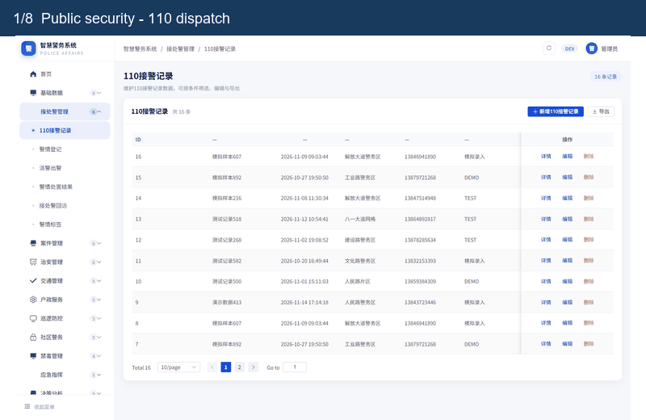
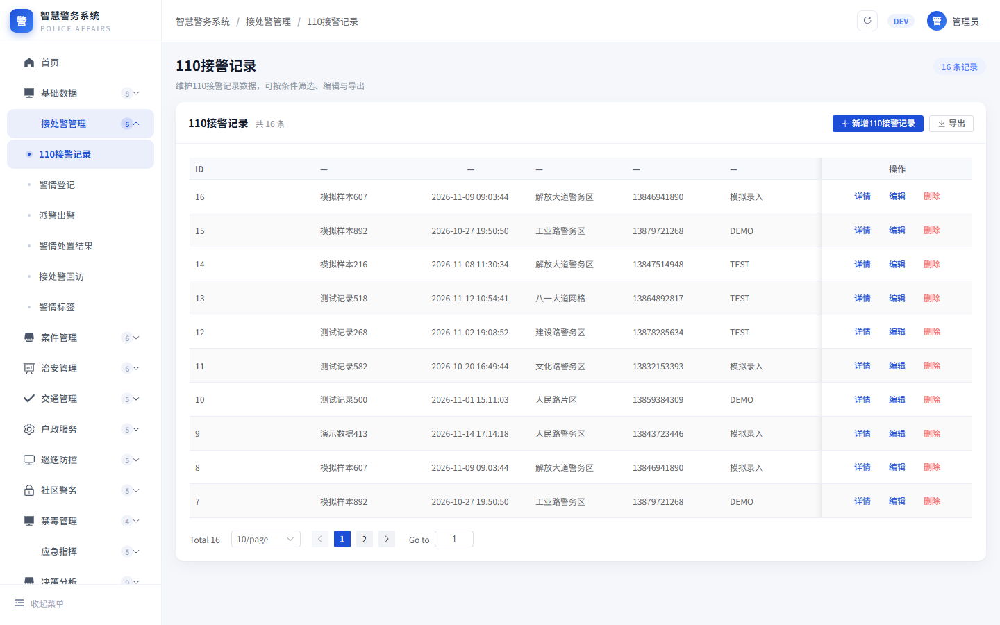
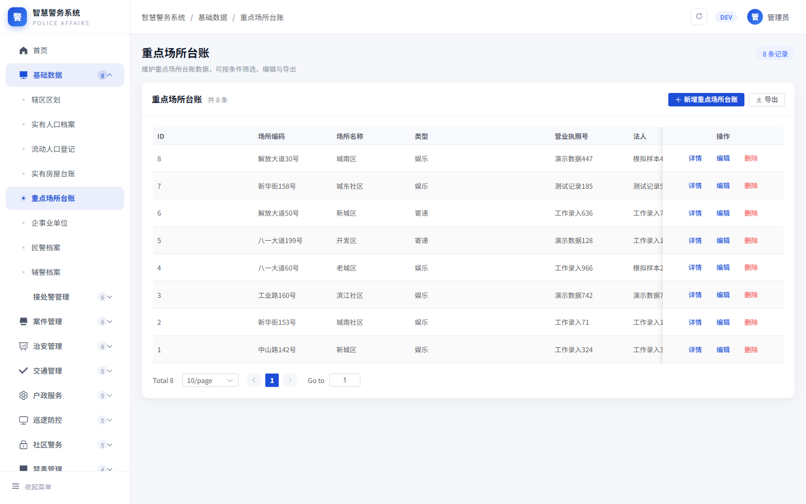
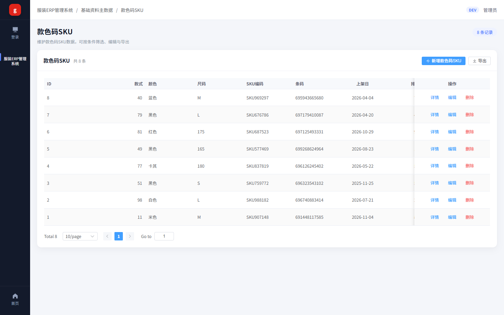
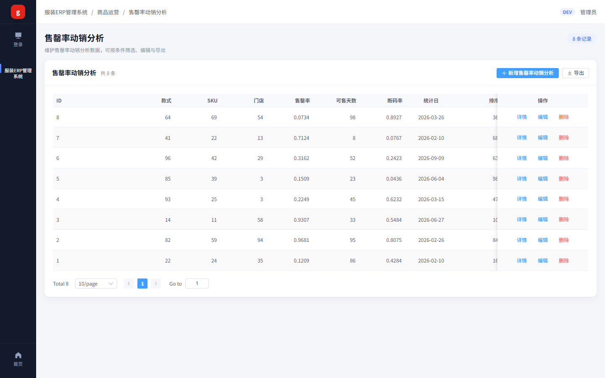
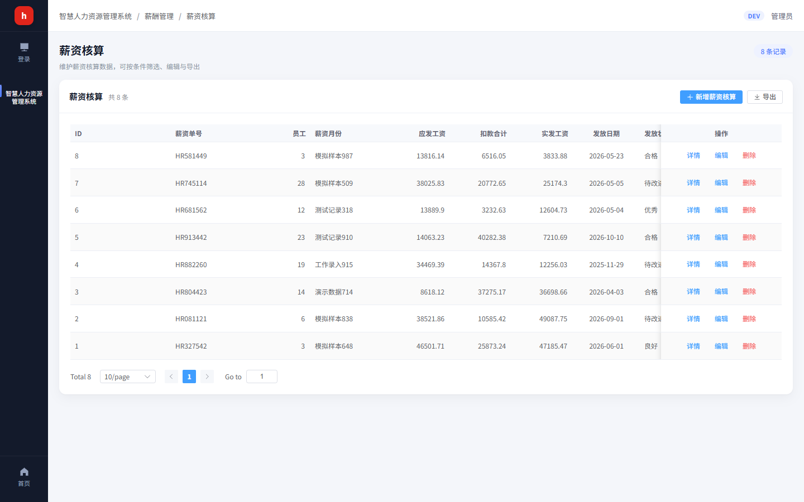
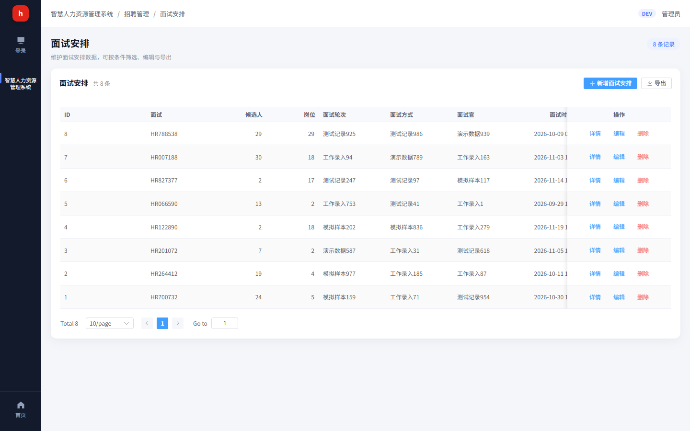
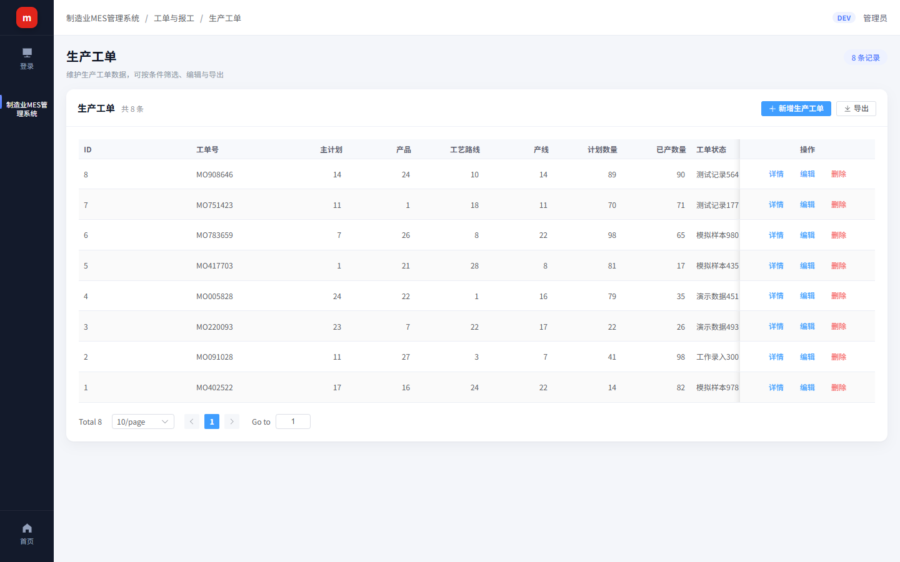
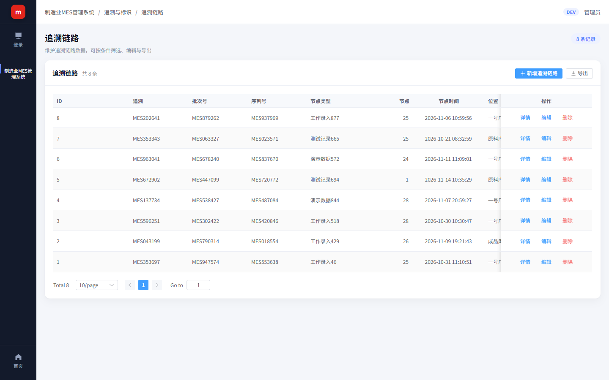

# 码匠 · 代码生成器（CodeGen）项目介绍

**Live demo:** [hustxia.github.io/CodeGen](https://hustxia.github.io/CodeGen/) · **Source:** [github.com/hustxia/CodeGen](https://github.com/hustxia/CodeGen)

> **参与 Roadmap：** [你最想生成哪个行业系统？](https://github.com/hustxia/CodeGen/issues/7) —— 留一条评论，你的场景会直接进入候选池。

[](https://github.com/hustxia/CodeGen/actions/workflows/verify.yml) [](https://github.com/hustxia/CodeGen/releases) [](https://github.com/hustxia/CodeGen/actions/workflows/verify.yml) [](https://hustxia.github.io/CodeGen/) [](LICENSE)


<details>
<summary>全部语言（48）</summary>

> Languages: **简体中文** · [繁體中文](README_ZH_TW.md) · [English](README.md) · [日本語](README_JA.md) · [한국어](README_KO.md) · [Türkçe](README_TR.md) · [Русский](README_RU.md) · [Tiếng Việt](README_VI.md) · [ไทย](README_TH.md) · [Deutsch](README_DE.md) · [Español](README_ES.md) · [Français](README_FR.md) · [Українська](README_UK.md) · [Polski](README_PL.md) · [Português (Brasil)](README_PT_BR.md) · [Português](README_PT.md) · [العربية](README_AR.md) · [فارسی](README_FA.md) · [Bahasa Indonesia](README_ID.md) · [Italiano](README_IT.md) · [Ελληνικά](README_EL.md) · [മലയാളം](README_ML.md) · [Roman Urdu](README_UR_ROMA.md) · [اردو](README_UR.md) · [Română](README_RO.md) · [Български](README_BG.md) · [हिन्दी](README_HI.md) · [বাংলা](README_BN.md) · [Nederlands](README_NL.md) · [Svenska](README_SV.md) · [Dansk](README_DA.md) · [Suomi](README_FI.md) · [Norsk](README_NO.md) · [Čeština](README_CS.md) · [Magyar](README_HU.md) · [Hrvatski](README_HR.md) · [Slovenčina](README_SK.md) · [Slovenščina](README_SL.md) · [Eesti](README_ET.md) · [עברית](README_HE.md) · [தமிழ்](README_TA.md) · [తెలుగు](README_TE.md) · [မြန်မာ](README_MY.md) · [ខ្មែរ](README_KM.md) · [Filipino](README_TL.md) · [Kiswahili](README_SW.md) · [Հայերեն](README_HY.md) · [ქართული](README_KA.md)

</details>


**从 DDL 到一个跑得起来的系统 —— 全部真实截图，绝非示意图：**

[](docs/images/showcase/demo.gif)

> **先看效果**：[在线演示](https://hustxia.github.io/CodeGen/)（国内可直连，无需注册安装）——真实生成系统首页实景 + V9.15 数据看板。489 个测试守护，已端到端生成 6 套完整业务系统（智慧警务 / 村务 / 服装 ERP / HR / MES / 学校人才培养方案）。

## 一眼看懂

**CodeGen 把数据库表结构变成可编译、可运行、自带菜单权限的 Spring Boot 3 + Vue3 业务系统。**

- **表驱动而非提示词驱动** —— 导入 DDL 或连接数据库，一次生成后端全栈代码与前端页面、路由、菜单，前后端不会漂移。
- **安全交付** —— 真实 `javac` 自检、写盘前备份、标记块合并保留手写代码、四态账本一键回滚。
- **先看效果** —— [在线演示](https://hustxia.github.io/CodeGen/)展示四套真实生成系统的首页与 V9.15 数据看板。

> 如果它帮你省下一天 CRUD 时间，请点个 Star，让更多开发者看到。

> **多语言支持**：生成的系统内置整页国际化，框架覆盖 **206 种语言**并可自动回退；其中 **12 种为专业翻译**（zh-CN、en-US、ja-JP、ko-KR、fr-FR、de-DE、es-ES、ar-SA、ru-RU、pt-BR、id-ID、vi-VN），其余语言统一回退到简体中文。想贡献翻译？见 [`多语言项目介绍/CONTRIBUTING.md`](多语言项目介绍/CONTRIBUTING.md)。

> 面向 **Spring Boot + Vue** 的多工程代码生成器：从数据库表结构出发，产出**可编译、可运行、带菜单权限**的前后端业务代码，并负责写盘、备份、记账、回滚的完整交付闭环。

---
github 地址：https://github.com/hustxia/CodeGen


## 实战截图 · 用 CodeGen 生成的系统

> 以下都是本生成器端到端生成的**真实可运行系统**——从数据库建表到前端页面、菜单与权限一应俱全。绝非示意图：每张图对应的列表都灌有真实数据。点击图片可查看大图。

**智慧警务 · 64 页 / 79 表** —— 依据功能设计文档一句话建系统，覆盖辖区数据、接处警记录、重点场所台账。

| 110 接警与警情登记 | 重点场所台账 |
| :---: | :---: |
| [](docs/images/showcase/police-110-dispatch.png) | [](docs/images/showcase/police-key-places.png) |

**服装 ERP · 71 页** —— 款色码矩阵、BOM 物料清单、缸号批次追溯、售罄率动销分析。

| 款色码 SKU | 售罄率与翻单分析 |
| :---: | :---: |
| [](docs/images/showcase/garment-sku.png) | [](docs/images/showcase/garment-sellthrough.png) |

**智慧人力资源 · 68 页** —— 组织人事、招聘、考勤、薪酬、绩效共 14 个 HR 业务域。

| 薪资核算 | 面试安排 |
| :---: | :---: |
| [](docs/images/showcase/hr-payroll.png) | [](docs/images/showcase/hr-interview.png) |

**制造业 MES · 68 页** —— 生产工单、质量门禁、设备管理、批次序列号追溯、安灯异常。

| 生产工单 | 批次追溯链路 |
| :---: | :---: |
| [](docs/images/showcase/mes-work-order.png) | [](docs/images/showcase/mes-traceability.png) |

> 每套系统都走过同一条 12 步流水线：DDL 预览 → 建库 → 生成 → 灌数据 → 全页验收（零空列表、零页面错误）。实战博文见 `docs/blog/`。

---

## 一、这是什么

CodeGen 是一套“以表为源”的代码工厂。你只要把业务表接进来（连库导入或贴一段 DDL），配置好字段与生成开关，点一下“生成”，它就替你把后端 Entity/Mapper/Service/Controller/DTO/VO、前端 api.js 与 Vue 页面、菜单与路由、甚至 A4 打印页和集成测试骨架全部生成好，并安全地写进你的目标工程。

它不只“吐代码”，而是一条**带质量门禁与回滚能力的交付流水线**：

```
接表（库导入 / DDL）
   → 字段与生成开关配置（含 AI 推荐）
      → 一键生成：自检 → 备份 → 写盘 → 编译/校验 → 注册菜单 → 重建路由
         → 台账记账 → 可回滚
```

---

## 二、用户是谁，会怎么用

| 使用者     | 典型诉求                     | 平台给的路径                  |
| ------- | ------------------------ | ----------------------- |
| 后端开发    | 手上有一批表（或 DDL），想快速拉起 CRUD | 表配置页：导入 → 配字段 → 一键生成    |
| 全栈/独立开发 | 想从零起一个完整系统（含登录、权限、字典）    | 流水线页：一句话建系统             |
| 团队负责人   | 想统一代码风格、代码规范、目录结构        | 系统管理：一套系统 = 一套输出配置，批量生效 |
| 平台维护者   | 想改模板而不改代码                | 模板管理：在线编辑，保存即生效，支持历史回滚  |

---

## 三、解决什么问题

| 痛点 | CodeGen 的做法 |
| --- | --- |
| 重复 CRUD 地狱，每张表都要手写一堆样板代码 | 表级开关一键产出完整前后端，含增删改查、分页、校验、导入导出 |
| 前后端字段/接口对不齐，联调反复改 | 同一份表元数据同时驱动后端接口与前端页面，字段语义零偏差 |
| 团队规范难以统一，每人写出来的风格各异 | 模板即规范，22 个 FreeMarker 模板集中管控、支持在线编辑与版本回滚 |
| 生成器“覆盖即丢失”，手写逻辑被冲掉 | 标记块（marker block）合并机制：手写代码被保留，只替换生成区 |
| 生成物不可信，编译才发现问题 | 内存编译自检（真实 javac）、结构契约检查、磁盘 diff 预览，编译不过不准落盘 |
| 新系统从 0 搭脚手架费时 | 流水线“一句话建系统”：建库→脚手架→生成→打包→注册菜单全自动 |

---

## 四、核心能力全景

- **接表**：DDL 解析、库表直连导入、批量接管向导、列配置自动推导（控件 / 校验 / 字典 / 关联）。
- **表形态**：单表、树形表（tree 接口 + 树表格）、主子表（同事务保存 + 明细 Tab）、多对多中间表。
- **生成产物**：Entity / Mapper / Service / Controller / DTO / VO + `api.js` + Vue 页面 + A4 打印页 + 集成测试骨架。
- **业务增强**：关联下拉、字典翻译、脱敏、唯一性校验、表单联动、数据权限、Excel 导入导出、审批流、支付 / 文件 / 移动端能力包，以及 V9.15 数据可视化图表包（`chart_enabled` 三态开关；饼/线/柱/仪表盘纯由列元数据推导、零领域关键词；每表 `/{module}/stats` 聚合接口 + 生成期字段白名单；ECharts 图卡与跨表看板、系列色跟随 `--app-primary`；关闭时产物零 diff）。
- **质量门禁**：内存编译自检（真实 `javac`）、结构契约检查、权限一致性检查、磁盘 diff 预览、前端产物真校验。
- **安全落地**：写盘 + `.gen-backup` 批次备份、标记块合并保留手写代码、`gen_output` 四态台账（新建 / 合并 / 跳过 / 失败）、历史回滚。
- **多系统隔离**：每套目标工程是一份“系统配置”（前后端路径、包名、网关前缀、依赖 classpath、生成开关默认值），可并行服务多个项目。
- **AI 增强**：一句话建系统（AI 建模）、种子数据 AI 增强、表级 AI 推荐配置（diff 预览 + 勾选应用）。

---

## 五、典型场景

| 场景 | 说明 |
| --- | --- |
| 树形表 | 商品分类等层级数据，自动产出 tree 接口与树表格、上级选择下拉 |
| 单表 CRUD | 客户、商品等，外键下拉 + 字典翻译 + 导入导出开箱即用 |
| 主子表 | 销售订单 + 订单明细，同事务保存，详情抽屉双 Tab（主表信息 / 明细） |
| 只读 / 统计 | 库存流水等，关闭增删改开关，仅保留查询与导出 |
| 打印单据 | 勾选“打印”开关，产出 A4 打印页与路由，支持表头 + 明细表 |
| 一句话建系统 | 描述业务域，AI 建库建表 + 脚手架 + 全量生成 + 注册菜单一气呵成 |

> 以上场景均有可运行演示（`demo_admin` 工程）与配套截图，详见 `docs/典型场景操作指南-演示后台demo.md`。

---

## 六、核心工作流

```
┌──────────┐   ┌──────────────┐   ┌───────────────────────────────────────┐
│  接表     │ → │  字段/开关配置 │ → │  一键生成（自检→备份→写盘→编译→菜单→路由）│ → │ 台账 · 回滚 │
└──────────┘   └──────────────┘   └───────────────────────────────────────┘
   库导入/DDL      控件/校验/字典       质量门禁全过才落盘，手写代码保留           批次级追溯
```

- **差异预览**：生成物与磁盘现状逐文件 diff，确认后再落盘，避免误覆盖。
- **生成台账**：每个文件记录动作、字节数、MD5、备份位置，批次可整体回滚。

---

## 七、一句话建系统（Pipeline）

面向“从零搭一个后台”的高阶能力。描述业务域后，流水线按 5 个阶段全自动推进：

| 阶段 | 含义 |
| --- | --- |
| `CHECK` | 校验目标工程配置与依赖 classpath |
| `WRITE` | 建库、建表、写脚手架与生成物 |
| `COMPILE` | 后端 `mvn package` / 前端构建，内存编译自检 |
| `MENU` | 产出并注册菜单权限（双出口：artifact SQL / internal 直写） |
| `ROUTE` | 重建前端路由片段 |

任一阶段失败即中断并给出可读错误，便于定位。

---

## 八、系统架构

前后端分离，两个仓库协同：

| 仓库 | 角色 | 技术栈 |
| --- | --- | --- |
| `codegen-server` | 后端：生成引擎、模板、校验、台账、流水线 | Java 21 · Spring Boot 3.2.5 · MyBatis-Plus 3.5.5 · FreeMarker · JWT · MySQL 8 · springdoc-openapi |
| `codegen-web` | 前端：控制台（表配置 / 模板 / 台账 / 系统管理） | Vue 2.7 · Element UI (platform console only; generated projects use Vue 3 + Element Plus + Vite) · axios · Vue Router(history) |

后端分层：

```
controller/   接口层（Gen* 生成链路 / Sys* 系统管理 / 流水线）
service/impl/ 核心实现（生成链路、模板引擎、合并、校验、流水线执行）
util/         模板引擎、模型装配、标记块合并、自检编译
config/       输出配置、自检配置、模板种子器
common/       Result / BaseEntity / 异常 / 审计
resources/gen-templates/   22 个 FreeMarker 模板（backend / frontend / shared / test 分组）
```

**目标工程必须自带的基座能力**（生成器只产业务代码，基座缺失会静默故障）：

1. MyBatis-Plus 分页插件（`PaginationInnerInterceptor`）
2. `Result` / `BaseEntity` / `PageQuery` 等基座类（包名前缀与 `root-package` 一致）
3. 前端 `utils/request.js` 的 `toPageData`（把 `Page{records,total}` 转成 `{list,total}`）
4. 依赖 `springdoc-openapi-starter-webmvc-ui`（生成物用 `@Operation`）与 `poi-ooxml`（Excel）

---

## 九、技术栈一览

| 维度 | 选型 |
| --- | --- |
| 后端语言 / 框架 | Java 21 / Spring Boot 3.2.5 |
| 持久层 | MyBatis-Plus 3.5.5 |
| 模板引擎 | FreeMarker（22 个种子模板，支持在线编辑 + 版本回滚） |
| 安全 | JWT 鉴权 |
| 数据库 | MySQL 8 |
| 前端 (generated projects) | Vue 3 + Element Plus + Vite |
| 前端 (platform console) | Vue 2.7 + Element UI |
| 本地 AI | qwen2.5-coder:7b（建模 / 推荐配置 / 种子数据增强） |
| 接口文档 | springdoc-openapi（Swagger UI） |

---

## 十、快速开始

### 1. 建库（13 张平台表 + 默认账号 admin/admin123）

```bash
mysql -uroot -p -e "CREATE DATABASE gen_platform DEFAULT CHARSET utf8mb4;"
mysql -uroot -p gen_platform < docs/sql/V1.0__init.sql
```

### 2. 配置目标工程

复制配置模板并按本机路径修改：

```bash
cp src/main/resources/application-local.yml.example src/main/resources/application-local.yml
```

`application-local.yml` 已在 `.gitignore` 中排除，不会提交。主要配置项：

```yaml
gen:
  output:
    backend-root: /path/to/your-target-project      # 生成物写盘基准
    frontend-root: /path/to/your-target-project
    frontend-path: demo-web                          # monorepo 时前端子目录
    backend-path: demo-server/src/main/java/com/demo
    package-name: com.demo
    root-package: com.demo                           # 生成物 import 基座类的前缀
  selfcheck:
    classpath: /path/to/your-target-project/demo-lib/*
```

自检的依赖目录这样导出：

```bash
cd your-target/demo-server
mvn dependency:copy-dependencies -DoutputDirectory=../demo-lib
```

### 3. 启动后端

```bash
mvn package -DskipTests
java -jar target/codegen-server.jar
```

服务默认端口 **8120**，接口文档 `/swagger-ui/index.html`。

### 4. 启动前端

```bash
cd ../codegen-web
npm install
npm run serve
```

前端默认端口 **9530**，`/dev-api` 代理到后端 8120。默认账号 `admin / admin123`。

### 5. 关键配置项

| 配置 | 说明 |
| --- | --- |
| `gen.output.*` | 生成物写盘路径、包名、模块映射 |
| `gen.selfcheck.classpath` | 自检内存编译的依赖 classpath，支持 `dir/*` |
| `gen.menu.outlet` | `artifact` 只产出菜单 SQL 与路由片段；`internal` 同时写入平台自身 `sys_menu` |

---

## 十二、最新更新

| 版本 | 更新内容 |
| --- | --- |
| **V9.27** | 菜单按功能域归位与后台 UI 优化：系统监控 / 测试中心 / 验证中心归入系统管理，MCP 归入项目与数据，三级 flyout 导航，主题色入口恢复，功能菜单全量对账（28 叶子 / 5 分组）。含 V9.26.1–V9.27.3 全部修复。 |
| **V9.26** | 菜单按功能域重构；行业范式 404 通过三级 flyout 路由修复。 |
| **V9.25** | 护栏澄清向导 + 28 条行业规则（SDD 工件链 M2.1）。 |
| **V9.24** | 质量门禁加固：SQL 按数字版本序迁移、幂等加列、H2 脚本补齐、模板契约修复 —— 620 项测试全绿。 |
| **V9.23** | MCP Server：Java Streamable HTTP 五工具 + 调用审计。 |
| **V9.22** | 行业范式模板市场与安装机制。 |
| **V9.21** | SDD 规格工件链 + Converge 对账（M1.1）。 |
| **V9.20** | 能力包 8 项缺口补齐：支付端点、打印扫码、安全数据范围、工作流设计器、多组唯一键、演示页加速。 |
| **V9.19** | 建模规模化收尾：DDL 分批创建、i18n 覆盖自动化（12 语言）、模板市场原型。 |
| **V9.18** | 生成质量提升：模板影响面预览、child_save_mode 三方合并、S8/S9 验证门禁。 |

## 十四、作者与技术支持

- **作者**：中国程序员（独立开发者）
- **联系邮箱**：`hustxiayuhong@126.com`
- **技术支持**：请用**中文**写邮件，附上问题描述、运行环境（JDK / MySQL / 版本号）与复现步骤

> 所有邮件我都会看，看到就会回复。问题反馈、功能建议、合作洽谈都欢迎。

---
