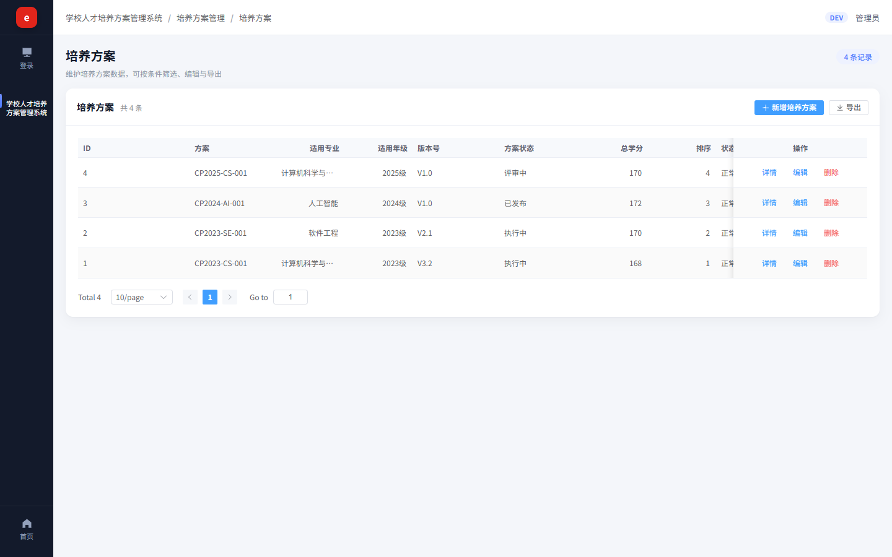
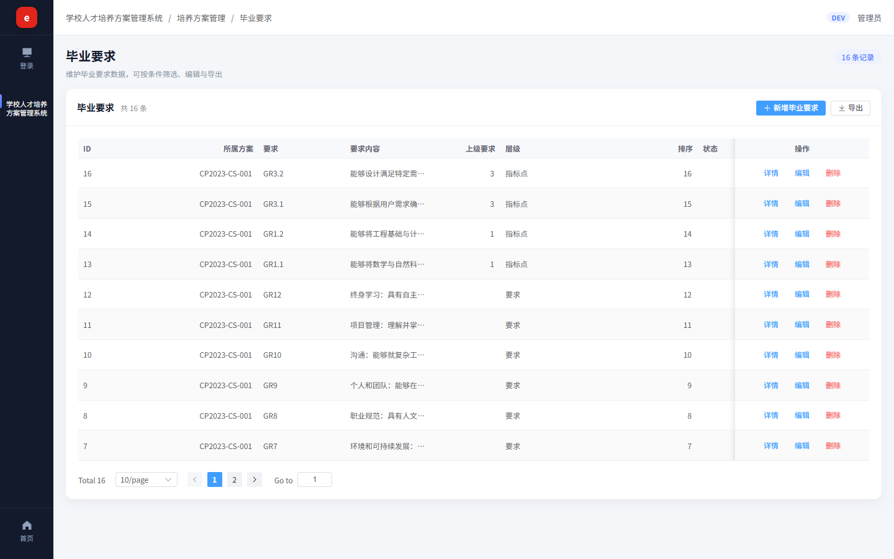
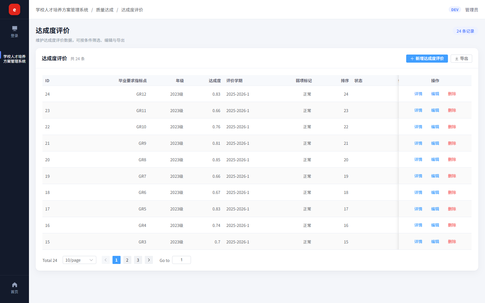
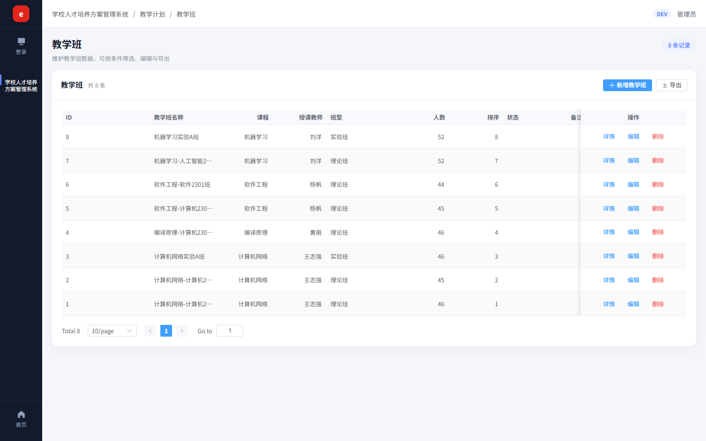
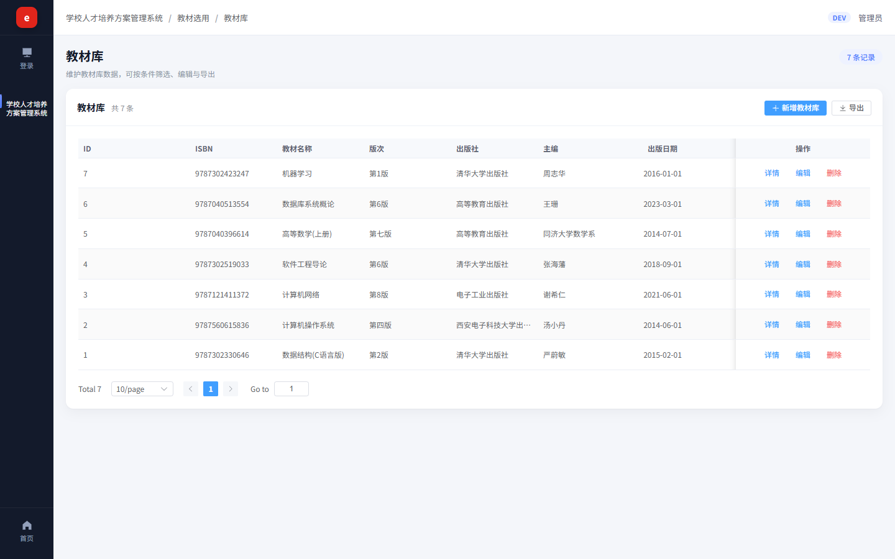
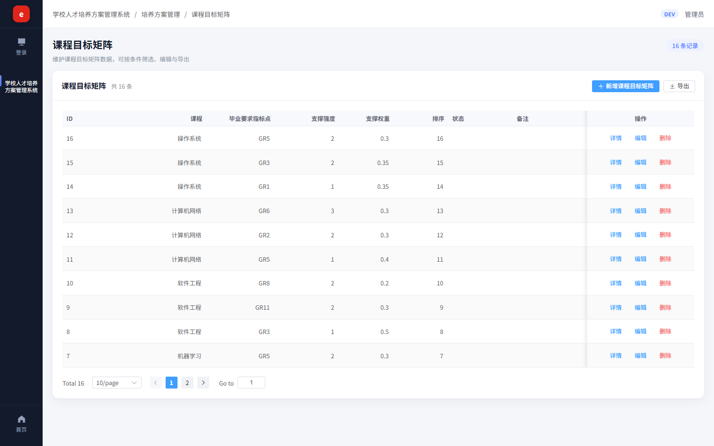

# 用代码生成器 7 分钟生成高校人才培养方案管理系统：66 张表落地 OBE 工程认证全流程

> 一个高校教务场景的完整实战：11 个业务域建模 → 12 步流水线生成 → 66 页菜单规划 → 真实业务演示数据 → OBE 达成度评价闭环。
> 附 6 张系统实拍截图，以及 5 个真实踩坑记录和修法。

> **代码仓库**：Gitee https://gitee.com/hustxiayuhong/CodeGen ｜ GitHub https://github.com/hustxia/CodeGen （觉得有用请点个 Star ⭐）
> **在线演示**：https://hustxia.github.io/CodeGen/ （浏览器直接看真实生成效果，无需安装任何东西）

---

## 一、先看效果

这是一个**完整能跑**的学校人才培养方案管理系统，不是静态原型：

- 后端 Spring Boot 3.2.5 + Java 21 + MyBatis-Plus + MySQL 8
- 前端 Vue 3 + Vite + Element Plus
- **66 张表（51 张业务表 + 15 张通用表）、66 个功能页面、198 个按钮权限**
- 12 个业务域菜单、登录态、菜单权限、审批流全部跑通
- 演示数据按真实高校教务口径灌入：8 个学院、10 个专业、33 门课程、12 名教师、7 本教材

**培养方案列表**（方案编号、适用专业/年级、版本号、状态全部中文，支持按条件筛选、编辑与导出）：



**毕业要求管理**（工程教育认证 12 条毕业要求，支持指标点两级结构）：



**达成度评价**（每条毕业要求按届计算达成度，低于阈值自动标记弱项）：



---

## 二、为什么选这个题目

高校教务处每年最头疼的工作之一就是**修订人才培养方案**：

- 一个专业一份方案，一份方案背后是培养目标、毕业要求、课程体系、学分结构、课程地图、支撑矩阵几十份文档
- 工程教育认证（OBE）要求"毕业要求 → 课程目标 → 教学环节"逐层可追溯，手工用 Excel 维护矩阵，改一门课要同步七八张表
- 方案修订要走"系主任 → 教学副院长 → 教务处备案"审批流，纸质材料来回传

这个场景的特点是：**表多、关系密、流程长、报表重**——正好是检验代码生成器成色的好题材。如果一行行手写 CRUD，66 张表意味着 66 个 Controller + 66 套 Vue 页面，还没算菜单、权限、审批。

---

## 三、建模：11 个业务域，66 张表

参考已有五套行业系统（村务、警务、HR、服装 ERP、MES）的建模范式，先把教务域拆成 11 个业务域 + 1 个系统域，一张表管一件事：

| 业务域 | 覆盖内容 | 代表表 |
|---|---|---|
| 基础数据 | 校区、学院、专业、专业方向、年级、学期日历 | edu_college / edu_major / edu_academic_term |
| 培养方案 | 方案、版本演进、培养目标、备案、附件 | edu_cultivate_plan / edu_plan_version |
| 毕业要求(OBE) | 毕业要求、指标点、达成度评价 | edu_grad_requirement / edu_obe_attainment |
| 课程体系 | 课程库、课程类别、课程组、先修关系、课程地图 | edu_course / edu_course_map / edu_prerequisite |
| 课程目标 | 课程目标与毕业要求支撑矩阵（强/中/弱 + 权重） | edu_course_objective |
| 学分管理 | 学分规则、毕业学分要求、选修课组、学分审核 | edu_credit_rule / edu_credit_requirement |
| 教学安排 | 学期教学计划、开课任务、教学班、课表、考核安排 | edu_teaching_class / edu_class_schedule |
| 教材管理 | 教材库、选用、审定、双语课程 | edu_textbook / edu_textbook_adoption |
| 实践教学 | 实践环节、实验项目、实习基地、认定竞赛 | edu_practice_item / edu_internship_base |
| 质量评价 | 评审批次、专家评审、评审意见、质量指标、就业追踪 | edu_review_batch / edu_quality_metric |
| 流程审批 | 审批单、审批节点、方案变更、执行跟踪 | edu_approval / edu_plan_adjustment |
| 系统管理 | 用户、角色、菜单、字典、日志、通知、任务、附件 | 15 张通用表 |

建模时定了两条铁律：**字段注释全中文**（生成页面的 label 直接来自注释），**外键全部可译**（`major_id → 适用专业` 这类映射进词库，页面不暴露技术字段名）。

---

## 四、生成：12 步流水线，6 分 40 秒

表结构定义好之后，剩下的交给流水线：

```
登录 → DDL 预览 → 建库建表 → 项目创建 → 环境自检
→ 后端生成 → 前端生成 → 菜单生成 → 打包 → 部署 → 健康检查 → 完成
```

66 张表一次性全过，`failReason=None`，从提交到前后端可访问用时 **6 分 40 秒**。每一步有独立的失败原因记录，DDL 预览与实际建库做了一致性校验，生成前就能发现字段类型问题。

---

## 五、菜单规划：12 个业务域的三级结构

生成的页面默认平铺，直接用没法看。按惯例重规划成三级：

```
一级：学校人才培养方案管理系统
  └── 二级：业务域（基础数据 / 培养方案管理 / 课程体系 / 毕业要求(OBE) / 教学安排 ... 共 12 个）
        └── 三级：功能页面（培养方案、方案版本、培养目标、毕业要求 ...共 66 页）
```

关键设计：**路由和菜单永远同源**。菜单树由路由表推导，页面路径写路由全路径（如 `/edu_plan/plan/edu_cultivate_plan/list`），菜单 SQL 与 `gen-routes.js` 由同一个脚本产出——这次就靠这个避掉了一个经典的"菜单路径与路由不一致导致整站白屏"的坑（见踩坑 4）。

**教学班管理**（关联课程、任课教师自动翻译成中文名称）：



---

## 六、演示数据：真实到"教务处拿来就能用"

空系统的截图没有说服力。这次灌了一套按真实高校教务口径编排的演示数据，主线是"**江城理工大学 计算机学院 2023 级计算机科学与技术专业培养方案 V3.2**"：

- **组织与专业**：8 个学院（计算机/电信/机械/经管/外语/数统/马院/体育部）、10 个专业（含 080901 计科、080717T 人工智能等真实专业代码）
- **课程体系**：33 门课，学分学时按真实口径（数据结构 4 学分=56 理论+16 实验），12 条先修关系（数据结构 ← C 语言 → 操作系统 → …）
- **OBE 全链路**：12 条毕业要求对应工程认证标准原文，16 条课程目标支撑矩阵（含权重），两届达成度评价（0.62~0.85，低于 0.65 自动标弱项）
- **运行数据**：2025-2026-1 学期的教学班、课表（周一 3-4 节 东九楼 D302）、期末考试安排（2026-01-08）
- **教材链**：《数据结构(C语言版)》《计算机网络(第8版)》等 7 本真实教材 → 选用理由 → 教学副院长审定
- **流程留痕**：专家评审意见（华中科大/武大/华为武研所）、审批节点处理记录、方案变更申请、审计轨迹

**教材库**（ISBN、版次、出版社、主编俱全）：



**课程目标矩阵**（课程 → 毕业要求 → 支撑强度 → 权重，认证材料直接可导出）：



---

## 七、踩坑实录：5 个真实问题与修法

### 坑 1：AI 菜单推荐对自定义表返回空

`ai-recommend` 接口对行业自定义表（`edu_*`）推荐结果为 0，且残留通用模板的推荐项。根因是推荐服务依赖内置表元数据，自定义表没进它的词库。
**修法**：不走 AI 推荐，用脚本按业务域重写 `gen-routes.js` + 生成三级菜单 SQL（幂等，可重复执行）。

### 坑 2：枚举"三件套"不收敛 → 表格假空白

页面 `Total 8` 但表格体空白，console 只有 `_ctx.enumText is not a function`。根因：生成器把 `enumText` 的**调用点**注入了所有页面，但**方法本体**和 `enumMap` 数据只注入到"有真实枚举命中"的页面，其余 64 页渲染函数直接抛错。
**修法**：补齐脚本扫描"调用无定义"页面，统一注入方法本体 + 默认枚举映射，再 build 验证。

### 坑 3：业务枚举错配到通用映射 → 状态列显示原始数字

"方案状态"列显示 2/3/4 而不是"评审中/已发布/执行中"。根因：生成器对所有 tinyint 枚举列统一生成 `enumText('status', row.planStatus)`，业务枚举值超出 status 的 0/1 域时命中失败，回退显示原值。
**修法**：按 camelCase 字段名建立独立枚举映射（`planStatus: [{1,草稿}...{5,废止}]`），enumText 第一参数与搜索下拉的选项来源（`enumMap.planStatus`）同步修正。

### 坑 4：菜单路径与路由全路径不一致 → 整站白屏

按菜单路径导航全部 404。根因：分组路由的完整路径是 `/edu_plan/<域>/<表>/list`，而菜单表里写的是 `/<表>/list`。
**修法**：菜单 SQL 的页面 path 改写为路由全路径，与路由表同源产出（见第五节）。截图脚本拍出来全是白屏才定位到，这个坑专门记进了坑库。

### 坑 5：polish 修改源码后忘记重新打包 → 运行中 jar 缺新端点

枚举/关联下拉的后处理改了源码，但流水线打包发生在 polish **之前**，运行中的 jar 里没有 `options` 端点，页面弹"服务异常"。
**修法**：所有源码级后处理完成后必须 `mvn package` + 重启，把"打包时间戳 vs 源码时间戳"检查加进验收清单。

这 5 个坑都已沉淀进项目的坑库，生成器模板层面同步修复了坑 2/3/4 的产生源头。

---

## 八、总结

| 指标 | 数值 |
|---|---|
| 业务表 / 总表 | 51 / 66 |
| 功能页面 / 按钮权限 | 66 / 198 |
| 流水线生成耗时 | 6 分 40 秒 |
| 演示数据 | 53 张表约 400 条真实业务口径记录 |
| console 错误 | 0 |

到目前为止，同一套生成器已经完整落地 **6 个行业系统**：智慧村务（85 表）、智慧警务、智慧人力资源、服装 ERP、制造业 MES、学校人才培养方案（66 表）。行业建模模板 + 12 步流水线 + 菜单同源 + 演示数据这四件事组合起来，"一句话到可运行系统"已经是可以稳定复现的工程流程，而不是演示魔法。

下一篇计划写：**生成器如何做"页面级后处理"**（枚举收敛、关联下拉、悬空外键清理的工程化方案），感兴趣可以关注。

---

## 如果这个项目帮到了你

- **点个 Star** ⭐：Gitee https://gitee.com/hustxiayuhong/CodeGen （无需代理，顺手一点）｜ GitHub https://github.com/hustxia/CodeGen —— 让更多开发者少写一天 CRUD
- **国内克隆**：直接用 Gitee 镜像：`git clone https://gitee.com/hustxiayuhong/CodeGen.git`
- **先看效果再决定**：[在线演示](https://hustxia.github.io/CodeGen/) 展示真实生成系统的首页与数据看板
- **遇到问题**：提 [Discussions](https://github.com/hustxia/CodeGen/discussions) 或 Issue，我会回复
