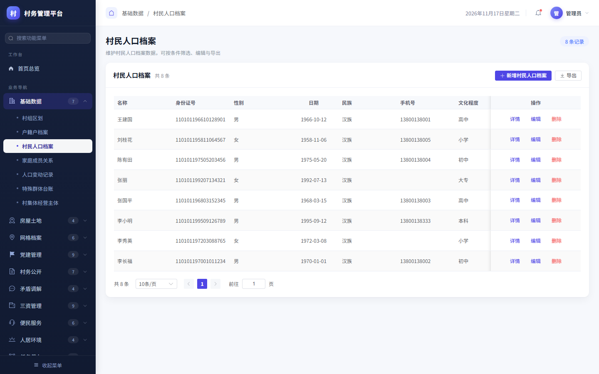
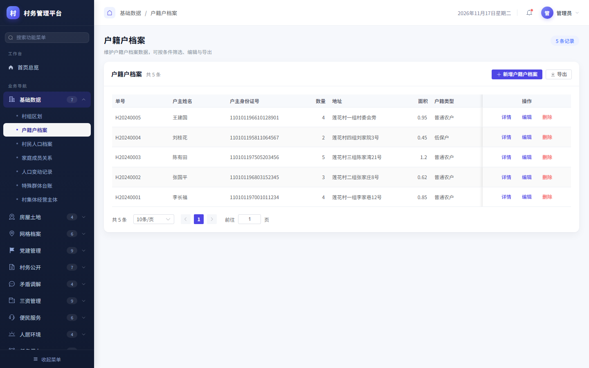
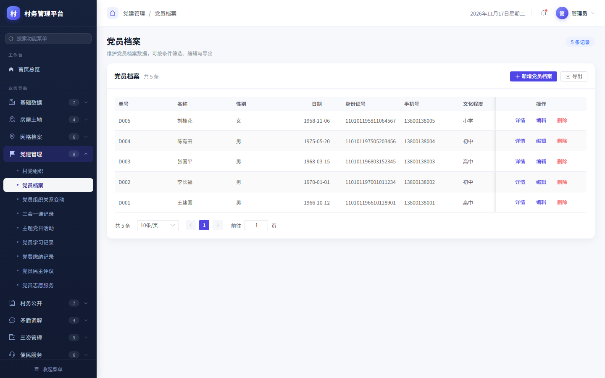
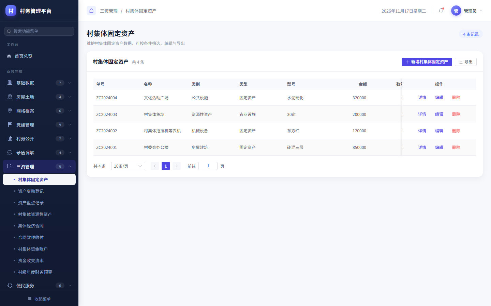
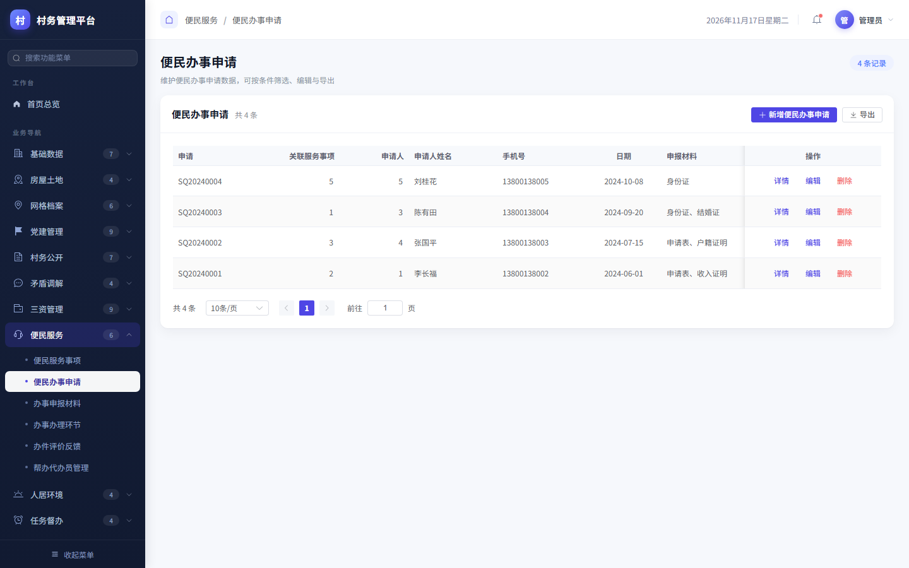
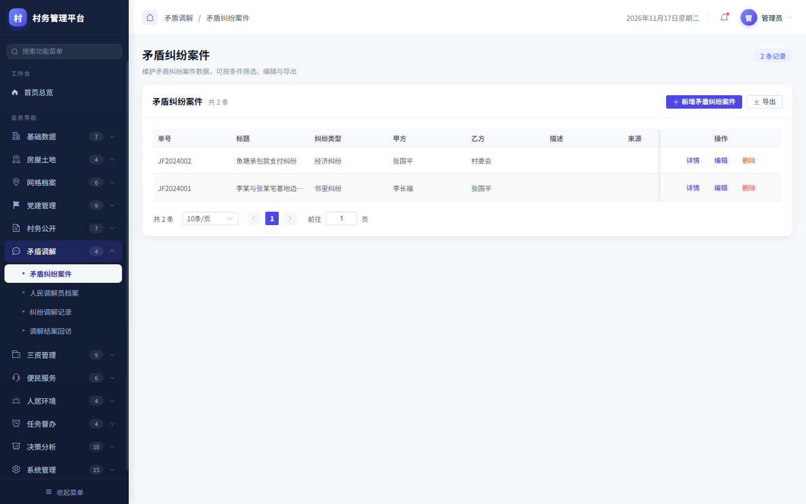
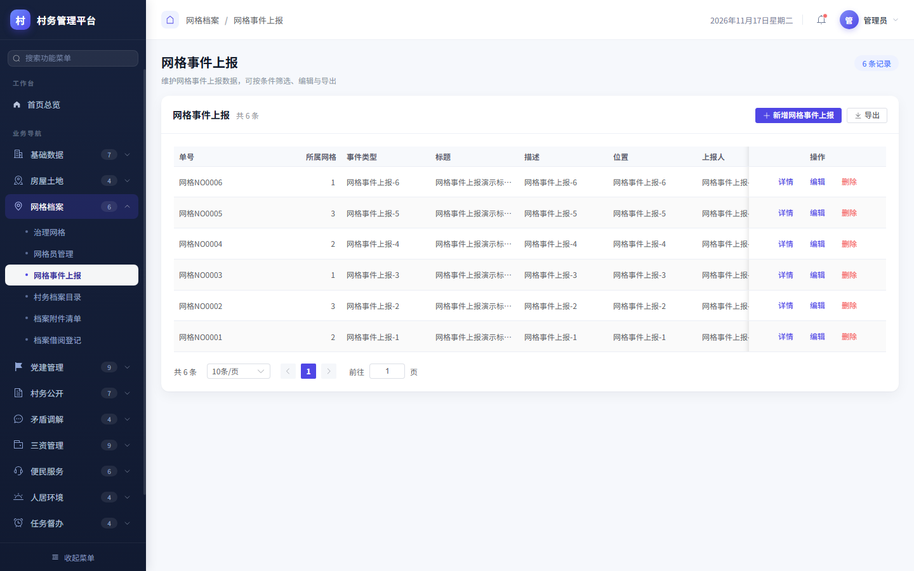
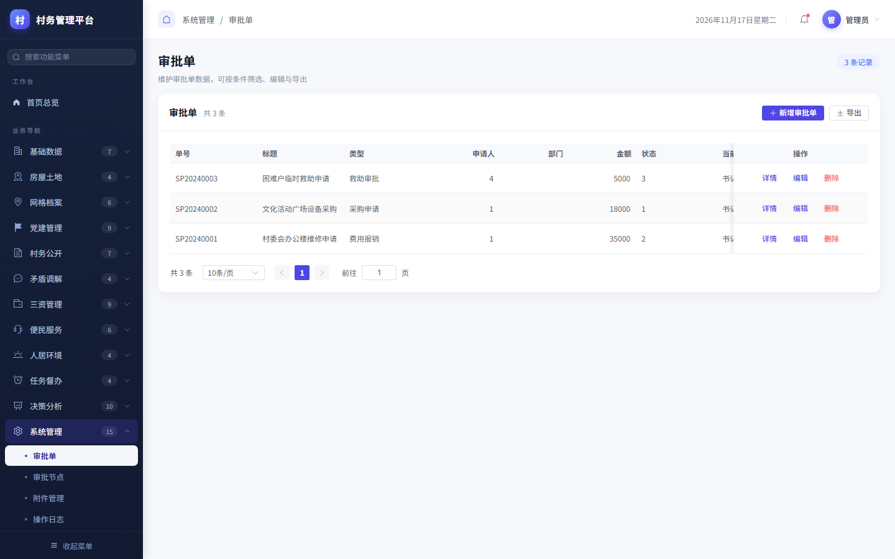

# 从 85 张表到能跑的系统：用自研代码生成器 3 小时搭出智慧村务管理平台

> 一个真实项目的完整记录：行业模板 → 一键生成 → 菜单规划 → 演示数据 → 审批流 → 首页统计 → 界面美化。
> 附 10 张系统实拍截图，以及一路上踩过的 6 个坑和修法。

---

## 一、先看效果

这是一个**完整能跑**的智慧村务管理系统，不是静态原型：

- 后端 Spring Boot 3.2.5 + Java 21 + MyBatis-Plus + MySQL 8
- 前端 Vue 3 + Vite + Element Plus
- **85 张业务表、1414 个字段**，覆盖 12 个村务业务域
- 90 张表 100% 有演示数据，首页 12 项指标实时统计
- 登录态、菜单权限、审批流全部跑通

**首页数据总览**（12 项业务指标实时统计，点击卡片直达对应模块）：


**仓储风格树形菜单 + 列表页**（左侧 12 个业务域，点击展开二级功能页面，可搜索、可折叠）：



---

## 二、为什么要做这个系统

村里的事情看起来小，但真要数字化，涉及的面非常广：户籍人口、房屋土地、网格治理、党建、村务公开、矛盾调解、三资管理、便民服务、人居环境、任务督办……随便一个域拆开来就是十几张表。

如果一行行手写 CRUD，85 张表意味着至少 **85 个 Controller + 85 个 Service + 85 套 Vue 页面**，还没算菜单、权限、流程。所以我用自己做的代码生成器（CodeGen）来做这件事——它本来就是"从表结构生成可运行的前后端业务代码"的工厂，这次刚好拿一个真实的大系统来压测它。

目标很明确：**不是生成"能编译的骨架"，而是生成一个"打开就能用、点进去有数据、流程能审批、"的完整系统。**

---

## 三、技术路线：两段式骨架 + 行业模板

直接对 85 张表逐张配置字段太慢，我走的是"两段式"：

**第一段：行业模板定骨架。** 预先定义好村务领域的 5 大模块：

| 模块 | 覆盖内容 |
|---|---|
| 基础数据底座 | 村组区划、户籍户、村民、家庭成员关系、人口变动 |
| 党建与治理 | 党组织、党员、党员活动、党费、志愿队 |
| 业务监管 | 资产资源、合同、资金流水、村务公开、矛盾调解 |
| 决策服务 | 统计报表、任务督办、满意度评价 |
| 平台通用能力 | 用户、角色、菜单、审批、附件、日志 |

模板里每张表带中文注释、字段类型、长度，一共 85 表 1414 字段。`village_affairs.json` 这一份模板，就是整个系统的"设计图纸"。

**第二段：生成器按模板批量产出。** 生成器读取模板 → 生成后端 Entity/Mapper/Service/Controller/DTO/VO + 前端 api.js + Vue 页面 → 注册菜单 → 重建路由 → 落盘。整个过程一次跑完，不用人工干预。

这里有个细节很关键：**字段注释必须全中文**。早期模板里外键注释是 `householdID` 这种英文 token，生成出来的页面 label 就直接把技术字段名暴露给用户了。后来我在生成脚本的词库里补了 52 个外键中文映射（`householdID → 所属户籍户`），并加了契约测试锁住"所有列注释不得是纯英文 token"，一次修到位。

---

## 四、菜单规划：12 个业务域的三级结构

生成出来的系统，菜单不能是"85 个页面平铺"，否则没法用。我把它规划成三级：

```
一级：系统（智慧村务）
  └── 二级：业务域（基础数据 / 房屋土地 / 网格档案 / 党建管理 / 村务公开 / ...共 12 个）
        └── 三级：功能页面（村民档案、户籍户档案、人口变动记录...）
```

用脚本 `village_menu_replan.py` 为 12 个业务域各配了 Element Plus 图标，并在路由 meta 里输出 `icon` 字段。前端菜单树直接从路由表推导，**路由和菜单永远同源**——不需要维护两份配置，删页面也不用改菜单。

列表页统一结构：搜索表单 + 数据表格 + 中文分页，字段 label 全部中文化（不暴露 `household_id` 这类技术字段名）。

户籍户档案：



党员档案：



---

## 五、演示数据：90 张表全填满

菜单能点开，但里面没数据，演示效果为零。我写了个 `village_fill_data.py` 脚本，从 `information_schema` 读每张表的列和类型，只给空表填数据（幂等，可重复跑）：

- 外键字段引用**关联表的真实 id**（比如村民的 `household_id` 指向真实户籍户），保证关联不悬空
- 状态、金额、编码按语义生成，日期按类型生成
- 90 张业务表 100% 覆盖，首页统计不再全是 0

固定资产台账：



便民服务申请（带审批流程）：



矛盾调解台账：



网格事件：



---

## 六、审批流跑通：从提交到通过

村务系统里"便民服务申请"需要走审批。这条链路踩了两个坑：

1. **提交时报 500**：流程任务表 `sys_flow_task.id` 没设自增，插入时 id 为空。修法：建表 DDL 里把 `id bigint NOT NULL AUTO_INCREMENT`，并用契约测试锁住。
2. **审批时报 403**：过滤器只认 token，没把 `userId` 注入上下文，审批人身份为空。修法：在生成的鉴权过滤器里，登录成功后按 username 查 `sys_user.id` 写入 `UserContext`。

审批单列表：



---

## 七、首页统计：12 项业务指标实时算

首页不是摆设，12 张卡片的数字都是真查数据库来的。后端加了个 `DashboardController`：

```java
@GetMapping("/stats")
public Map<String, Object> stats() {
    // 白名单表 COUNT，表名硬编码不接受外部入参（防注入）
    for (String table : WHITE_TABLES) {
        Long count = jdbcTemplate.queryForObject(
            "SELECT COUNT(*) FROM " + table, Long.class);
        metrics.add(new Metric(key, label, count, unit, icon));
    }
}
```

前端用 `<component :is="m.icon">` 动态渲染图标，点击卡片 `$router.push` 直达对应业务域。数据总量 51 条、待办 5 件、12 项指标全部非 0。

---

## 八、界面美化：从"能看"到"好看"

功能跑通后，界面还是偏粗糙。最后一轮做了视觉升级：

- **仓储风格侧边栏**：230px 常驻树形菜单，业务域可展开/搜索/折叠，二级菜单选中态白底深字
- **免登录打开即用**：启动自动签发演示会话，去掉登录页和跳转守卫（生产环境可关）
- **主题色统一**：`--el-color-primary` 覆盖，按钮/链接/分页和侧栏同色
- **统计卡片轻量化**：浅色图标底 + 低饱和色板，去掉刺眼的彩色块
- **Element Plus 中文化**：分页显示"共 8 条 / 10条/页 / 前往 1 页"

---

## 九、踩坑清单

| # | 现象 | 根因 | 修法 |
|---|---|---|---|
| 1 | 页面 label 显示 `householdID` | 模板外键注释是英文 token | 补中文词库 52 项 + 契约测试 |
| 2 | 菜单图标不显示 | 用了不存在的 `Map` 图标 | 改用 `MapLocation`，逐名校验 |
| 3 | 日期字段写入报 `Data truncated` | 只看列名判类型，`service_time` 是 int | 先看列类型再决定生成日期 |
| 4 | 流程提交 500 | `sys_flow_task.id` 无自增 | DDL 加 `AUTO_INCREMENT` |
| 5 | 审批 403 | `UserContext.userId` 为空 | 过滤器按 username 注入 userId |
| 6 | 左上角显示 `__BRAND_MARK__` | 产物里误用脚手架占位符 | 产物写真实 logo，模板才用占位符 |
| 7 | 5 个页面全报"服务异常" | 列名 `desc`/`rank`/`condition`/`usage` 是 MySQL 保留字，MyBatis-Plus 拼 SQL 没加反引号 → `ERROR 1064` | 实体模板按 MySQL 8 完整 261 个保留字自动输出 `@TableField("\`col\`")` |

**第 7 条值得单独说**：前 6 个页面截图里有数据，唯独"网格事件上报"顶部挂着红色"服务异常"，列表空空。前端 `catch` 把 500 吞成了空列表，所以有的页面只显示"暂无数据"、有的弹提示——**同一个 bug 两种表象**。根因是模板按驼峰映射列名时没考虑保留字，`SELECT id, desc FROM ...` 直接语法错误。修法不是给那 5 个实体逐个打补丁，而是在 `entity.ftl` 里内置 MySQL 8 保留字表（从 `information_schema.keywords` 导出，共 261 词），命中列名就输出带反引号的 `@TableField`，并写渲染级契约测试锁住。

**通用经验**：凡是"生成系统"的坑，八成出在**模板/产物不一致**——改了生成器模板忘了同步已有产物，或反过来。我的做法是把关键约束都写成契约测试（模板中文注释、图标有效性、免登录链路、菜单结构、保留字转义），改完跑一遍全量测试（478 项），谁回退都能第一时间发现。

---

## 十、总结

这个项目让我确认了一件事：**代码生成器的价值不在"生成得快"，而在"生成的东西能不能真的跑起来"。**

85 张表、1414 字段，从模板到可运行系统，中间要解决菜单规划、数据填充、流程审批、统计聚合、界面美观这一整串问题。生成器只覆盖了前半段，后半段靠的是脚本 + 契约测试 + 一轮轮 Actual 验证。

目前这套东西已经沉淀成 255 套行业模板 + 45 个版本迭代，仓库在 [GitHub](https://github.com/hustxia/CodeGen)。如果你也在做代码生成器，希望这篇踩坑记录对你有用。

---

*本文所有截图来自真实运行系统（后端 8140 / 前端 9040），非设计稿。*
