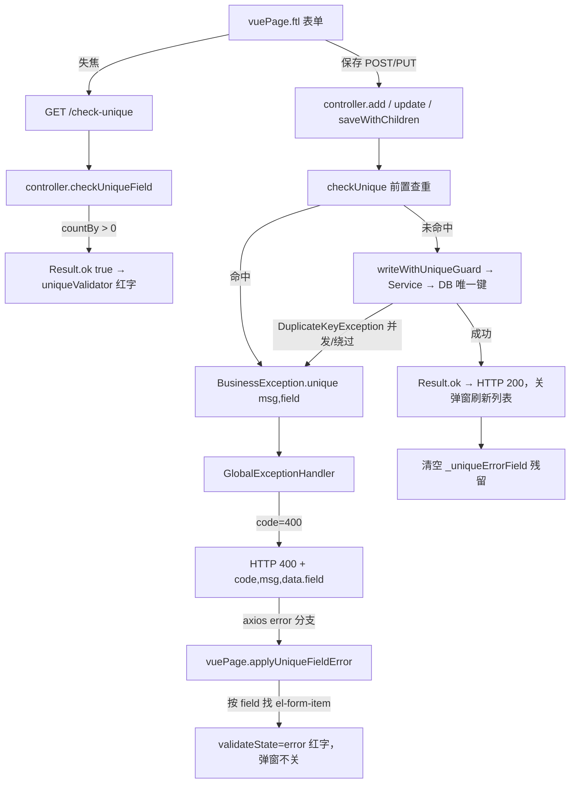

# V9.17 唯一性校验对齐-设计

> 目标：把生成物「唯一性冲突」的**后端返回**与**前端提示**钉在同一份契约上。
> 冲突时后端统一返回 **HTTP 400 + `{code:400, msg, data:{field}}`**，前端把红字挂到
> 对应 `el-form-item`，而不是只弹一个 toast。
>
> 本轮只改授权范围：`controller.ftl`、`saveDto.ftl`、`vuePage.ftl`、
> `ScaffoldCommonWriter.java`、`docs/design/` 本文档、`src/test/java/com/codegen/` 测试。

## 1. 侦查结论（现状）

V6.7 已经搭好了半条链路，V9.17 是补齐而不是重写：

| 环节 | V6.7 现状 | 缺口 |
| --- | --- | --- |
| `saveDto.ftl` | 唯一列有注释，说明 `data.field` | 注释里的字段名未与前端断言绑定 |
| `controller.ftl` | `checkUnique(dto, excludeId)` 前置查重，冲突 `new BusinessException(400, msg, field)` | ① 400 是散落魔法数字；② check-then-insert 有并发竞态；③ 绕过页面直接调接口/DB 唯一键冲突时走 `DuplicateKeyException` → 兜底 500，不是 400 |
| `ScaffoldCommonWriter` | `BusinessException` 已带 `field` + 三参构造；`GlobalExceptionHandler` 已把 `code=400` 映射真实 HTTP 400 | 缺一个统一入口，调用点各自拼 400 和字段名 |
| `vuePage.ftl` | 失焦查重 `uniqueValidator`；保存失败 `applyUniqueFieldError` 读 `data.field` 挂红字 | ① 只认 `data.field`/`msg` 一种形状，宿主拦截器改形状就失效；② 换字段提交后旧红字残留；③ 非 400 错误也进解析逻辑 |
| `serviceImplSimple.ftl` 等 | 无唯一性方法，查重集中在 Controller | 经评估**不需要改**：Service 保持纯 CRUD，查重口径由 Controller 常量统一，避免 Service/Controller 两套字段名漂移 |
| `codegen-web` 平台前端 | 平台自身是生成器控制台，不承接生成物的查重交互 | 本轮不改平台前端 |

## 2. V9.17 补齐点

1. **统一 400 入口**：`ScaffoldCommonWriter.businessExceptionJava()` 增加
   `BusinessException.unique(message, field)` 工厂，`code` 取 `ResultCode.PARAM_ERROR`（400），
   不再由模板调用点写魔法数字；旧构造全部保留，既有生成代码不受影响。
2. **DB 唯一键兜底**：`controller.ftl` 在 `add` / `update` / `saveWithChildren` 的落库处包一层
   `writeWithUniqueGuard(Runnable)`，捕获 `DuplicateKeyException` 并翻成同一份 400 错误体。
   前置 `checkUnique` 与兜底共用两个生成期常量 `UNIQUE_CONFLICT_MSG` / `UNIQUE_CONFLICT_FIELD`。
3. **DTO 契约可见**：`saveDto.ftl` 唯一列注释写明 400 结构与 `data.field` 的具体字段名。
4. **前端稳健解析**：`vuePage.ftl` 的 `applyUniqueFieldError` 只在 `code===400` 时生效，
   兼容 `{code,msg,data:{field}}` 与 `{code,message,field}` 两种形状，清理上一次字段红字；
   成功后重置残留。
5. **测试与文档**：模板渲染断言 + Java 侧契约断言 + 本设计文档。

## 3. 链路图



## 4. 错误码与字段名约定

| 项 | 约定 | 来源（同源保证） |
| --- | --- | --- |
| HTTP 状态 | 唯一冲突 **400**；其它业务错误维持 HTTP 200 + body `code` 旧契约 | `GlobalExceptionHandler` 的 `ex.getCode() == 400` 分支 |
| body.code | `400`（= `ResultCode.PARAM_ERROR`） | `BusinessException.unique()` 工厂 |
| body.msg | `"<列注释>已存在"`；联合唯一为 `"A+B组合已存在"` | `UNIQUE_CONFLICT_MSG` 模板常量 |
| body.data.field | 冲突字段名，如 `code`；联合唯一取首列 | `UNIQUE_CONFLICT_FIELD` = `${uniqueColumns[0].javaField}` |
| 前端定位键 | `el-form-item.prop` = 后端 `data.field` | 同表同列模型渲染，均为 `${c.javaField}` |
| 查重接口 | `GET {apiBase}/check-unique?field=&value=&excludeId=`；失焦校验排除自身 id | `uniqueValidator` + `checkUniqueField` |

前端额外兼容 `{code:400, message, field}` 扁平写法：宿主如果改写了 request 拦截器，
仍可读到冲突字段；**生成物自身始终输出 `{code,msg,data.field}`**，以 `crudControllerTest.ftl`
的 `status().isBadRequest()` / `$.data.field` 断言为准，本轮未改该模板。

## 5. 「不改变既有合法请求的成功路径」

唯一性校验是含唯一列表的默认生成行为，这里不谈「零 diff 开关」，谈的是**成功路径零改动**：

- 所有新增模板输出全部包在 `<#if hasUnique>` / `<#if c.uniqueFlag>` 内。
  **没有唯一列的表，生成产物逐字节不变**（`GenTemplateBaselineTest` 的 simple / relation /
  master-detail 等 6 个场景均无唯一列，可直接证明）。
- 成功保存仍是 `Result.ok()` → HTTP 200 `{code:200,...}`；`writeWithUniqueGuard` 正常分支
  只是同步执行写入，`Runnable` 不改变事务边界与返回值。
- 新增的 `BusinessException.unique` 是**追加**静态工厂，旧构造（ResultCode / String /
  (code,msg) / (code,msg,field)）签名和 `code`、`field` 赋值逐字保留。
- 前端 `applyUniqueFieldError` 只在 400 时动手，其它错误仍由 request 拦截器统一提示。

生成块边界：`writeWithUniqueGuard` 与常量放在 `<gen:begin key="controller-body">` 内，
与其调用点一起被重新生成；`vuePage` 的改动在 `<!-- <gen:begin key="vue-page"> -->` 方法块内。
这样存量工程二次生成时不会「调用点更新了、兜底方法还是旧的」。

## 6. 验证方法

**本轮不跑 `mvn`，由中央统一验证。** 交付的自动化断言：

1. `src/test/java/com/codegen/template/V917UniquenessAlignTemplateTest.java`
   - 用真实 Freemarker 渲染 `controller.ftl` / `saveDto.ftl` / `vuePage.ftl`；
   - 断言 400 工厂、唯一键兜底、字段名常量、`data.field` 解析、`el-form-item` 红字定位；
   - 断言同一列模型的字段名在前后端产物中一致；
   - 反向断言：无唯一列时不生成任何查重/兜底代码。
2. `src/test/java/com/codegen/service/impl/UniqueConflictErrorBodyTest.java`（扩充）
   - 断言 `BusinessException.unique(msg, field)` 工厂固定取 `ResultCode.PARAM_ERROR`（400）并透传 field；
   - 原有断言继续覆盖 `field` 字段、HTTP 400 映射、`data.field` 组装、其它异常分支未动。

中央验证建议执行：

```bash
mvn -q test -Dtest=V917UniquenessAlignTemplateTest,UniqueConflictErrorBodyTest,GenTemplateBaselineTest,TplRenderTest
```

人工验收（生成含唯一列的表后）：

1. 生成单表，把 `code` 列设为唯一，启动产物工程；
2. 新增一条 `code=ABC`，刷新再新增同值 → 保存返回 HTTP 400，body 为
   `{"code":400,"msg":"编码已存在","data":{"field":"code"}}`；
3. 页面上「编码」输入框下出现红字「编码已存在」，弹窗保持打开，列表不刷新；
4. 修改其它字段后重试成功 → 红字消失，弹窗关闭，列表刷新。

## 7. 未尽事项与风险

- **多组独立唯一约束**：现有模型用 `uniqueFlag` 标记列，`hasSingleUnique=(uniqueCols.size()==1)`，
  多列一律按「一组联合唯一」处理（同时相等才算重复，冲突 field 取首列）。
  一张表上两组互不相干的唯一键暂不支持，需模型层扩展，超出本轮授权范围。
- **前端拦截器形状**：`applyUniqueFieldError` 读 `e.response.data`；若宿主 request 拦截器把
  错误体重构成非对象（如直接抛字符串），字段级提示会静默跳过，只剩拦截器 toast。
  兼容了 `message`/`field` 扁平写法，但无法覆盖任意自定义变形。
- **并发竞态窗口**：`writeWithUniqueGuard` 依赖 DB 唯一键；若目标表未真正建唯一索引，
  前置 `checkUnique` 仍可能在并发下双写成功。生成器只生成查重逻辑，DDL 唯一索引由表配置负责。
- **存量工程二次生成**：`checkUnique` 位于 controller 的手写区（gen:end 之后），
  老工程二次生成不会替换到工厂写法；但旧构造仍存在，行为与错误体不变，
  新的 DB 兜底方法在 gen 块内会被正常更新。
- **未执行构建**：按约定未在本地跑 `mvn`，模板语法与生成物编译以中央验证结果为准。
