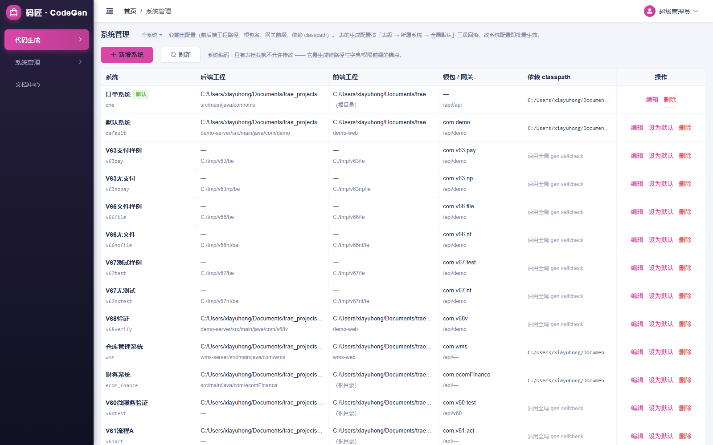
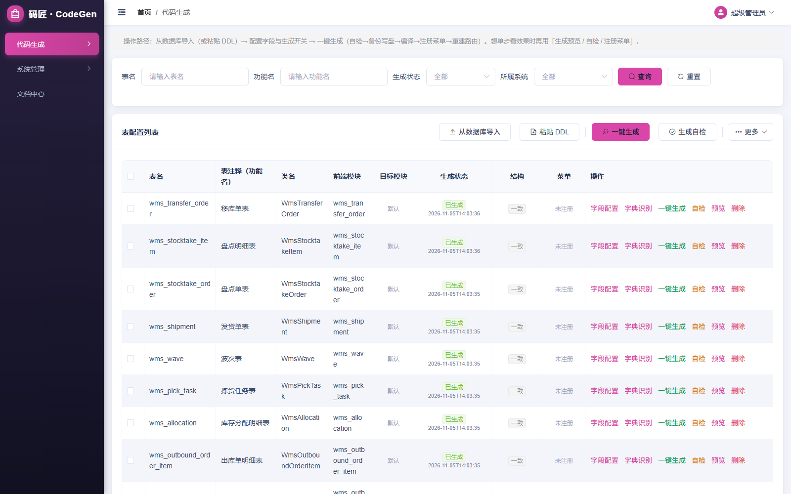
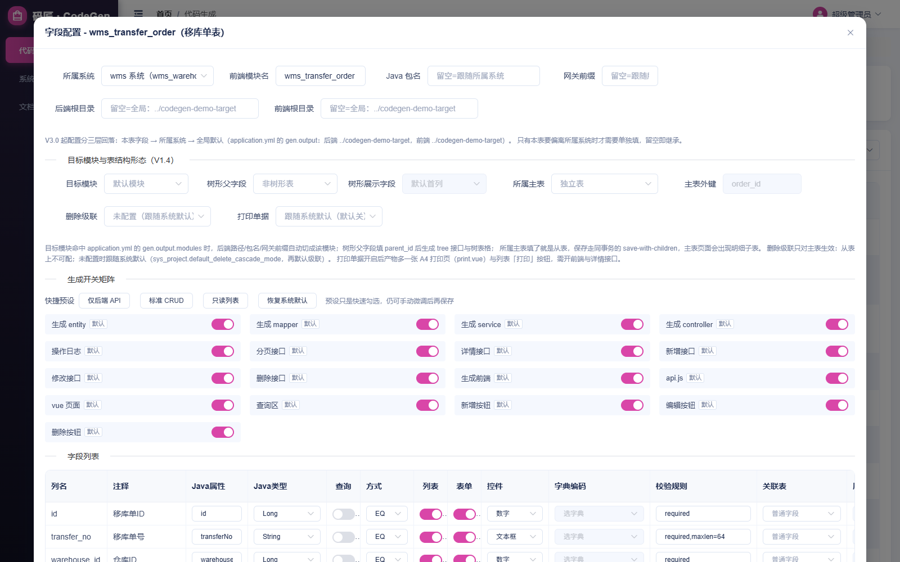
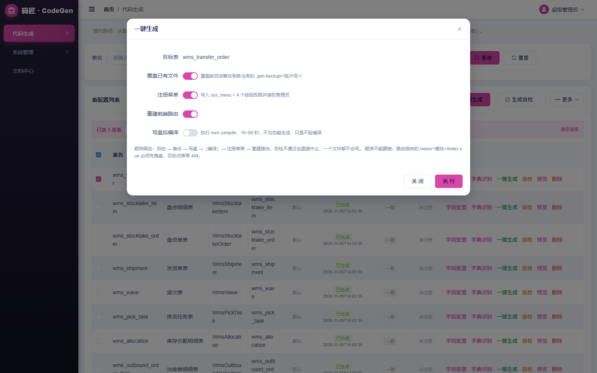
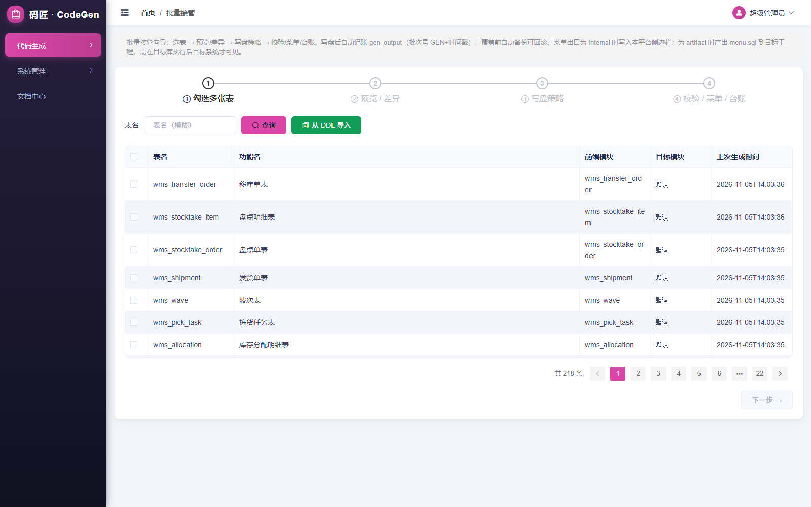
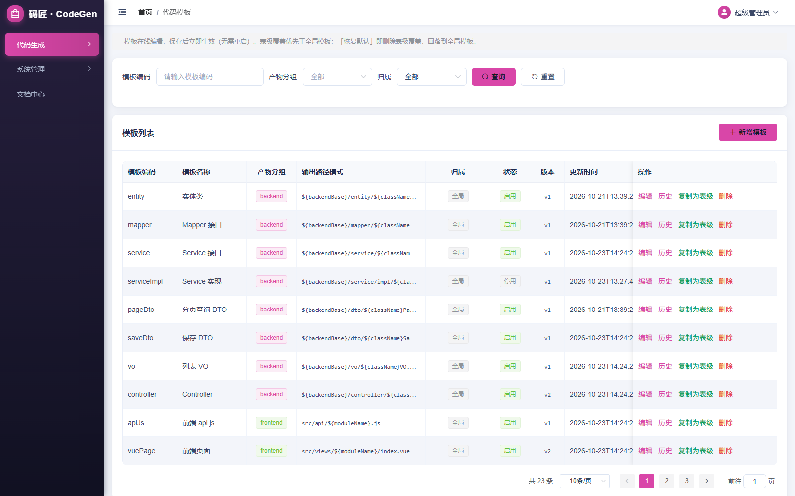
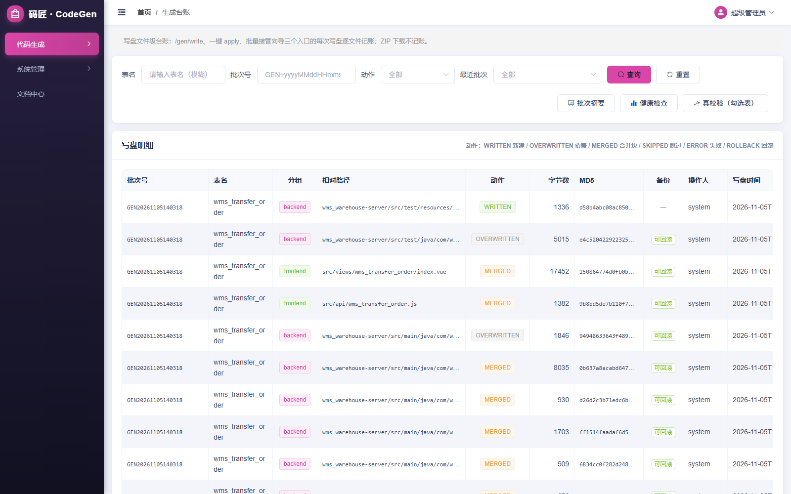
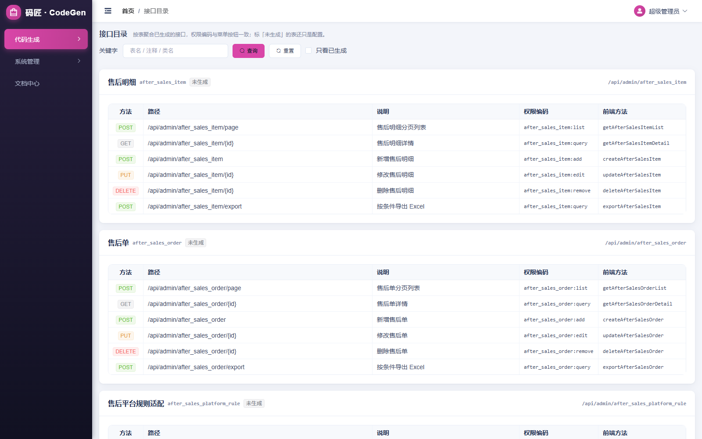
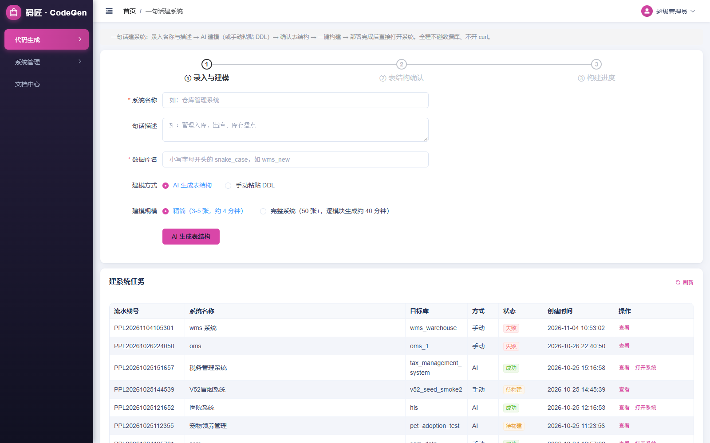

# 代码生成器操作手册（V7.3）

| 项目   | 说明                                                                             |
| ---- | ------------------------------------------------------------------------------ |
| 适用版本 | CodeGen 平台 V7.3（后端 `codegen-server` · 前端 `codegen-web`）                        |
| 技术栈  | Java 21 · Spring Boot 3.2.5 · MyBatis-Plus · FreeMarker / Vue 2.7 · Element UI |
| 读者对象 | 使用本平台生成业务代码的开发者、平台管理员                                                          |
| 配图说明 | 截图取自运行中的示例环境（`codegen-demo-target`），你的数据会不同                                    |
| 最后更新 | 2026-11-06                                                                     |

---

## 目录

1. [认识代码生成器](#1-认识代码生成器)
2. [部署与启动](#2-部署与启动)
3. [五分钟快速上手](#3-五分钟快速上手)
4. [系统管理（多系统配置）](#4-系统管理多系统配置)
5. [代码生成（表配置）](#5-代码生成表配置)
6. [批量接管向导](#6-批量接管向导)
7. [代码模板管理](#7-代码模板管理)
8. [生成台账](#8-生成台账)
9. [接口目录](#9-接口目录)
10. [一句话建系统（流水线）](#10-一句话建系统流水线)
11. [典型场景操作指南](#11-典型场景操作指南)
12. [生成物清单与工程集成](#12-生成物清单与工程集成)
13. [常见问题排查](#13-常见问题排查)
14. [附录](#14-附录)

---

## 1. 认识代码生成器

### 1.1 解决什么问题

从数据库表结构出发，产出**可编译、可运行、带菜单权限**的前后端业务代码，并负责写盘、备份、记账、回滚的完整交付闭环。核心流程：

```
接表（库导入 / DDL）→ 配置字段与生成开关 → 一键生成
    （自检 → 备份 → 写盘 → 编译 → 注册菜单 → 重建路由）
        → 台账记账 → 可回滚
```

### 1.2 核心概念

| 概念                       | 说明                                                                  |
| ------------------------ | ------------------------------------------------------------------- |
| **系统（SysProject）**       | 一套目标工程的输出配置（前后端路径、包名、网关前缀、依赖 classpath、生成开关默认值）。表挂到哪个系统，就按哪个系统的配置生成 |
| **表配置（GenTable）**        | 一张业务表在平台内的"档案"：类名、前端模块、树形/主从属性、生成开关、字段清单                            |
| **字段配置（GenTableColumn）** | 列级配置：Java 属性/类型、查询方式、控件、字典、校验规则、关联下拉、Excel 导入导出                     |
| **模板（GenTemplate）**      | FreeMarker 模板，23 个种子模板分 backend/frontend/shared/test 四组；支持在线编辑与表级覆盖 |
| **批次（batchNo）**          | 每次写盘的编号，格式 `GEN+yyyyMMddHHmmss`；备份与回滚都按批次组织                         |
| **台账（gen_output）**       | 写盘文件级账本：每个文件的动作、字节数、MD5、备份位置                                        |
| **菜单出口（outlet）**         | `artifact`：只产出菜单 SQL 与路由片段；`internal`：同时写平台自身 sys_menu              |

### 1.3 能力全景

| 阶段  | 能力                                                                          |
| --- | --------------------------------------------------------------------------- |
| 接表  | DDL 解析、库表直连导入、批量接管、列配置自动推导（控件/校验/字典/关联）                                     |
| 表形态 | 单表、树形表（tree 接口 + 树表格）、主子表（同事务保存 + 明细 tab）、多对多中间表                            |
| 生成  | Entity/Mapper/Service/Controller/DTO/VO + api.js + Vue 页面 + A4 打印页 + 集成测试骨架 |
| 增强  | 关联下拉、字典、脱敏、唯一性校验、表单联动、数据权限、Excel 导入导出、审批流、支付/文件/移动端能力包                      |
| 校验  | 内存编译自检（真实 javac）、结构契约检查、权限一致性检查、磁盘 diff、前端产物真校验                             |
| 落地  | 写盘 + `.gen-backup` 批次备份、标记块合并保留手写代码、gen_output 四态台账、历史回滚                    |
| 配套  | 菜单权限双出口、前端路由自动重建、模板版本化管理、多系统隔离、微服务/多模块脚手架                                   |
| AI  | 一句话建系统（AI 建模）、种子数据 AI 增强、表级 AI 推荐配置（diff 预览 + 勾选应用）                         |

---

## 2. 部署与启动

### 2.1 环境要求

| 组件      | 要求                                          |
| ------- | ------------------------------------------- |
| JDK     | 21（后端编译与运行）                                 |
| MySQL   | 8.x（平台库 `gen_platform`）                     |
| Maven   | 3.6+（后端构建；流水线打包目标工程也会用到）                    |
| Node.js | 14+（前端 dev server）                          |
| 目标工程    | Spring Boot 3.x 后端 + Vue 前端（见 2.5 基座要求）     |
| LLM（可选） | OpenAI 兼容接口（Ollama / 云端均可），仅 AI 建模与 AI 推荐需要 |

### 2.2 初始化数据库

```bash
mysql -uroot -p -e "CREATE DATABASE gen_platform DEFAULT CHARSET utf8mb4;"
mysql -uroot -p gen_platform < docs/sql/V1.0__init.sql
# 增量脚本按文件名顺序执行（V2.0 → V6.8，全部幂等，重复执行安全）
for f in docs/sql/V2.*.sql docs/sql/V3.*.sql docs/sql/V4.*.sql docs/sql/V5.*.sql docs/sql/V6.*.sql; do
  mysql -uroot -p gen_platform < "$f"
done
```

初始化完成后：13 张平台表 + 默认账号 `admin / admin123` + 基础菜单。

### 2.3 后端配置

复制模板并按本机路径修改（该文件在 `.gitignore` 中，不会提交）：

```bash
cp src/main/resources/application-local.yml.example src/main/resources/application-local.yml
```

最常用的覆盖项：

```yaml
gen:
  output:
    backend-root: /path/to/your-target-project   # 生成物写盘基准
    frontend-root: /path/to/your-target-project
    frontend-path: demo-web                       # monorepo 前端子目录
    backend-path: demo-server/src/main/java/com/demo
    package-name: com.demo
    root-package: com.demo                        # 基座类 import 前缀
  selfcheck:
    classpath: /path/to/your-target-project/demo-lib/*   # 自检依赖
  menu:
    outlet: artifact        # artifact=产出 SQL；internal=直写平台菜单
  pipeline:
    ai:
      enabled: true         # AI 建模 / AI 推荐开关
      base-url: http://127.0.0.1:11434/v1
      api-key: ollama
      model: qwen2.5-coder:7b
```

自检依赖目录这样导出（对目标工程执行一次即可）：

```bash
cd your-target/demo-server
mvn dependency:copy-dependencies -DoutputDirectory=../demo-lib
```

### 2.4 启动

```bash
# 后端（默认端口 8120，接口文档 /swagger-ui.html）
mvn package -DskipTests
java -jar target/codegen-server.jar

# 前端（默认端口 9530，代理到 8120）
cd codegen-web && npm install && npm run serve
```

浏览器打开 `http://localhost:9530`，默认账号 **admin / admin123**。

> 多系统部署时每个系统可在「系统管理」里单独配置依赖 classpath，优先级高于全局 `gen.selfcheck.classpath`。

### 2.5 目标工程必须自带的基座能力

生成器只产出业务代码，以下基础件需由目标工程提供，**缺失会导致静默故障**：

1. **MyBatis-Plus 分页插件**（`PaginationInnerInterceptor`）——没有它列表数据正常但 `Page.total` 恒为 0，分页器算不出总页数；
2. **`Result` / `BaseEntity` / `PageQuery`** 等基座类，包名前缀与 `root-package` 一致；
3. **`utils/request.js` 的 `toPageData`**，把后端 `Page{records,total}` 转成页面的 `{list,total}`；
4. pom 依赖 `springdoc-openapi-starter-webmvc-ui`（生成物用 `@Operation`）与 `poi-ooxml`（Excel 导入导出）。

---

## 3. 五分钟快速上手

以给目标工程新增一张标准 CRUD 表为例：

1. **配置系统**：「代码生成 → 系统管理 → 新增系统」，填系统编码/名称、前后端工程根、根包名。见 [第 4 章](#4-系统管理多系统配置)。
2. **接表**：「代码生成 → 代码生成 → 从数据库导入」，选库 → 勾表 → 选择所属系统 → 导入。
3. **配字段**：列表点「字段配置」——检查 Java 属性/类型、勾选查询列与查询方式、按需配控件/字典/校验；顶部「快捷预设」一键套用标准开关组合。
4. **一键生成**：勾选表 → 点「一键生成」→ 默认开关（覆盖 + 注册菜单 + 重建路由）→ 执行。阶段结果逐行展示，全 PASS 即完成。
5. **验证**：写盘后编译（可选）通过 → 打开目标前端，侧边栏出现新菜单，增删改查可用。

> 单步操作（预览 / 自检 / 注册菜单 / 下载 ZIP）在「更多」下拉里，想看中间产物时再用。

---

## 4. 系统管理（多系统配置）



一个系统 = 一套输出配置。**系统编码一旦有表挂载就不允许修改**——生成物路径与菜单挂载都按它插桩。

### 4.1 新增 / 编辑系统

列表页「+ 新增系统」，可选「复制配置自」现有系统快速起步。关键字段：

| 字段                  | 说明                                                         |
| ------------------- | ---------------------------------------------------------- |
| 系统编码 / 名称           | 编码唯一且挂表后不可改；名称用于界面显示                                       |
| 后端工程根 / 后端相对路径      | 生成物写盘基准；相对路径如 `demo-server/src/main/java/com/demo`         |
| 前端工程根 / 前端相对路径      | 同上；前端是独立仓库时前端根填仓库根、相对路径留空                                  |
| 根包名                 | 生成物 import 基座类的前缀，必须与目标工程实际包一致                             |
| 工程结构                | 空=单模块；`multi`=多模块（微服务就绪）；`micro`=微服务设施（Nacos/网关/Feign 脚手架） |
| 流程引擎                | 空=内置简易流（状态机直线流）；`activiti`=Activiti 8（BPMN/待办中心）           |
| 网关前缀                | 生成 Controller 的 `@RequestMapping` 前缀                       |
| 依赖 classpath        | 该系统自检编译用依赖目录，支持 `dir/*`                                    |
| 应用显示名 / 品牌主色 / Logo | 生成到前端页面的品牌参数                                               |
| 状态                  | 停用后不可被选为生成目标                                               |

### 4.2 功能包与默认开关

编辑弹窗下方还有三组配置：

- **功能包**（开启后生成对应基座与页面）：`gen_deploy` 部署、`pay_enabled` 支付（收银台+支付记录）、`mobile_enabled` 移动端、`file_enabled` 文件上传、`test_enabled` 集成测试骨架；
- **生成开关默认**：17 项生成开关（entity/mapper/service/…/新增按钮）的**系统级默认值**，新导入的表按它落地；表级可再改；
- **删除级联默认 / 打印默认**：主子表删除行为（级联/阻止/不处理）与 A4 打印页的系统默认。

---

## 5. 代码生成（表配置）

平台的主工作页。



### 5.1 列表与状态语义

| 列    | 含义                                      |
| ---- | --------------------------------------- |
| 生成状态 | 「已生成」+ 最近生成时间 / 「未生成」                   |
| 结构   | 「一致」或「漂移 N」——数据库表结构相对配置有了新增/缺失列；点「同步」拉平 |
| 菜单   | 「已注册」显示 sys_menu 关联 ID                  |
| 目标模块 | 表配置了 `target_module` 时显示，未配置显示「默认」      |

筛选支持：表名、功能名、生成状态（已生成过/从未生成/结构有漂移/已注册菜单）、所属系统。

### 5.2 三种接表方式

| 方式         | 入口          | 适用                                              |
| ---------- | ----------- | ----------------------------------------------- |
| **从数据库导入** | 工具栏「从数据库导入」 | 目标库可直连：选 schema → 过滤 → 勾表 → 绑定系统；已导入的表会标状态      |
| **粘贴 DDL** | 工具栏「粘贴 DDL」 | 拿不到库连接时，粘 `CREATE TABLE`（一次一条），自动推导字段配置，可先预览再保存 |
| **批量接管向导** | 菜单「批量接管」    | 一次接一批表并直接走生成流程，见 [第 6 章](#6-批量接管向导)             |

### 5.3 字段配置



「字段配置」弹窗自上而下四块：

**① 表级基础区**：所属系统、前端模块名、Java 包名、网关前缀、前后端根目录——**留空 = 继承所属系统默认**，只有本表要偏离系统配置时才填。

**② 目标模块与表结构形态区**：

| 配置             | 说明                                                          |
| -------------- | ----------------------------------------------------------- |
| 目标模块           | 命中 `gen.output.modules` 映射时，后端路径/包名/网关前缀自动切成该模块（微服务场景按表落模块） |
| 树形父字段 / 树形展示字段 | 父字段填 `parent_id` 后生成 tree 接口与树表格                            |
| 所属主表 / 主表外键    | 填了即从表：保存走同事务 `save-with-children`，主表页面出现明细子表                |
| 删除级联           | 仅主表可配：级联（同步删明细）/ 阻止（有明细拒删）/ 不处理；未配置跟随系统默认                   |
| 打印单据           | 开启后产物多一张 A4 打印页（`print.vue`）与列表「打印」按钮                       |

**③ 生成开关矩阵**：17 项开关 + 快捷预设——

| 预设      | 行为                  |
| ------- | ------------------- |
| 仅后端 API | 只生成后端接口，不生成前端       |
| 标准 CRUD | 全套后端 + 前端页面 + 增删改按钮 |
| 只读列表    | 分页/详情接口 + 查询页面，无写接口 |
| 恢复系统默认  | 清掉表级覆盖，回落所属系统默认值    |

**④ 字段列表**：逐列配置，列含义见下表。

### 5.4 字段级配置速查

| 列                 | 说明                                                                                                                                   |
| ----------------- | ------------------------------------------------------------------------------------------------------------------------------------ |
| Java属性 / Java类型   | 生成实体的字段名与类型（Long/String/BigDecimal/LocalDateTime…）                                                                                   |
| 查询 + 方式           | 是否进查询区；方式 EQ / LIKE / GE / LE                                                                                                        |
| 列表 / 表单           | 是否出现在列表、是否进表单                                                                                                                        |
| 控件                | input / textarea / number / select / radio / switch / date / datetime；留空按类型推断                                                        |
| 字典编码              | select/radio 的字典项，从下拉选（字典不足先去「系统管理 → 字典管理」补）                                                                                         |
| 校验规则              | 逗号分隔：`required`、`maxlen=50`、`min=1`、`max=9999`、`email`、`phone`、`url`、`regex=^\d+$`；同时生成后端 `@NotBlank/@Size/@Min` 注解与前端 el-form rules |
| 关联表 + 展示字段        | 填了生成远端搜索下拉（el-select remote），值存 id、展示取展示字段（默认 name）                                                                                  |
| Excel导出 / Excel导入 | 控制该列是否进导出文件与导入模板                                                                                                                     |


> **高级属性**（已进入生成链路，界面暂未开放控件，可通过保存接口设置）：  
> 脱敏 `mask_type`（phone/idcard/email/name/bankcard，VO getter 与列表渲染走脱敏）、  
> 唯一性 `unique_flag`（多列组合成联合唯一校验）、  
> 表单联动 `link_rule`（JSON）、  
> 数据权限 `data_scope`（dept/self，启动时向拦截器登记）、  
> 中间表外键 `relation_key`（由「多对多识别」自动标记）。

### 5.5 批量操作

勾选多张表后出现批量操作条：

| 操作            | 说明                                                                             |
| ------------- | ------------------------------------------------------------------------------ |
| 批量设置          | 开关预设（不改 / 仅后端 / 标准 CRUD / 只读）、转移所属系统、改前端模块/包名/作者/根目录/网关前缀；**只改配置不触发生成**；留空项不修改 |
| AI 推荐配置       | 见 5.7                                                                          |
| 批量一键生成 / 批量自检 | 同单表，作用于勾选集合                                                                    |
| 差异预览          | 生成内容与磁盘现状的行级 diff                                                              |
| 批量删除          | 删除表配置（不删库表、不动已生成文件）                                                            |

### 5.6 单表操作

操作列从左到右：**字段配置 → 字典识别 → 一键生成 → 自检 → 预览 → 删除**。

- **字典识别**：扫描列注释里的枚举词（如「状态：0启用 1停用」），一键生成字典类型与数据并回填 `dictType`；
- **多对多识别**（「更多」里）：识别中间表与两侧外键，自动标记 `relation_type=middle` 与 `relation_key` 列；
- **同步列**：数据库加列/删列后把配置拉平（新增列按类型推导默认配置，缺失列清理）。

### 5.7 AI 推荐配置（V7.3）

针对**同一系统**下勾选的表，让 LLM 给出建模建议并按需应用：

1. 勾选表 → 「AI 推荐配置」→ 服务端调 LLM 产出**建议 diff**（表名、模块名、列级改名/改类型等）；
2. 对话框逐条展示变更前后对比，**勾选想要的项目**（人工标记的项默认不勾）；
3. 点应用：仅勾选项写库。建议值全程在服务端持有（token 签发），不经客户端转手，安全可控。

> 交互约束：跨系统勾选会提示分批操作；token 有效期外需重新预览；同系统只保留最近 5 份推荐产物。

### 5.8 一键生成



弹窗四个开关：

| 开关     | 默认 | 说明                                               |
| ------ | -- | ------------------------------------------------ |
| 覆盖已有文件 | 开  | 覆盖前自动备份到各仓库 `.gen-backup/<批次号>/`                 |
| 注册菜单   | 开  | 写 sys_menu + 查询/新增/修改/删除 4 个按钮权限并授权管理员；已注册的表自动跳过 |
| 重建前端路由 | 开  | 写入目标前端 `src/router/gen-routes.js`                |
| 写盘后编译  | 关  | 执行 `mvn compile`（10~60 秒）；不勾也能生成，只是不验编译          |

**阶段顺序固定：自检 → 备份 → 写盘 →（编译）→ 注册菜单 → 重建路由。**  
自检不通过会直接中止，一个文件都不会写；顺序不能颠倒——路由指向的 `views/<模块>/index.vue` 必须先落盘，否则点菜单 404。

执行后逐阶段展示 PASS/SKIPPED/FAILED 与耗时，可展开看逐文件明细；有写入时提供「**回滚这一批**」按钮。

### 5.9 预览 / 差异 / 自检 / 注册菜单 / ZIP

「更多」下拉：

| 操作     | 说明                                                                |
| ------ | ----------------------------------------------------------------- |
| 生成预览   | 内存渲染全部产物文件清单与内容，不落盘                                               |
| 差异预览   | 渲染结果与磁盘文件的行级 diff（新增/修改/无变化/文件已不存在）                               |
| 注册菜单   | 弹窗里选父菜单 ID（0=顶级）、授权角色（留空取管理员）、是否同步路由；支持先「预览」再「注册」                 |
| 下载 ZIP | 全部产物打 zip 下载（**不记台账**）；解压后按相对路径合并，路由片段 `router-snippet.txt` 需手动追加 |

### 5.10 回滚

两个入口：一键生成结果里的「回滚这一批」；或「生成台账 → 批次摘要 → 回滚」。回滚前有**预览**：逐文件展示「台账动作 → 将执行的动作」，手改过的文件会标注并默认跳过，确认后执行。

---

## 6. 批量接管向导

适合"一次接一批表并直接生成"的场景，四步走完。



| 步骤             | 内容                                                                |
| -------------- | ----------------------------------------------------------------- |
| ① 勾选多张表        | 从表配置列表勾选；也支持「从 DDL 导入」临时建配置                                       |
| ② 预览 / 差异      | 左侧文件树 + 右侧行级 diff；标记 NEW / MODIFIED / UNCHANGED / 已手改（漂移）/ 文件已不存在 |
| ③ 写盘策略         | 三选一（见下）+ 「写盘后动作」：注册菜单并重建路由（可选挂载父菜单，幂等）                            |
| ④ 校验 / 菜单 / 台账 | 校验报告逐文件展示结果与说明；菜单注册结果；台账确认                                        |

**写盘策略**：

| 策略        | 行为                                        |
| --------- | ----------------------------------------- |
| 同名跳过（推荐）  | 磁盘已存在的文件不写入记 SKIPPED，仅新增文件落盘，最安全          |
| 覆盖，但跳过已手改 | 先备份；标记块内替换、块外手写代码保留；相对上次生成被人工改过的文件一律跳过并说明 |
| 强制覆盖      | 不看漂移全部按合并规则写入（仍备份）；手改内容可能被块内替换，动手前先看差异页   |

> **受保护文件**：没有台账快照（不是平台生成的）文件默认跳过不覆盖，防止误伤手写代码。

---

## 7. 代码模板管理



- **在线编辑，保存即生效**（无需重启服务）；
- **表级覆盖优先于全局模板**：全局模板行上「复制为表级」→ 选目标表 → 改内容后，该表生成时用表级版本；表级行上「恢复默认」即删除覆盖回落全局；
- **校验**：编辑器里点「校验」做 FreeMarker 语法检查，再保存；
- **历史**：每次保存产生版本记录，可查看任意版本内容并「回滚到此版本」；
- **状态**：停用的模板不参与渲染（一般不要停用种子模板）。

种子模板 23 个，按产物分组：

| 分组       | 模板                                                                                               |
| -------- | ------------------------------------------------------------------------------------------------ |
| backend  | entity、mapper、service、serviceImplSimple/Tree/Masterdetail（按表形态三选一）、pageDto、saveDto、vo、controller |
| frontend | apiJs、vuePage、printPage（A4 打印）、flowApi、flowTodo（审批流）、payApi、payCashier、payOrderPage（支付能力包）       |
| shared   | routerSnippet（路由片段）、readme（使用说明）                                                                 |
| test     | crudControllerTest（集成测试）、testSchemaTable（H2 建表）                                                  |

> 升级平台时，未被用户改过的种子模板会自动同步到新版本；用户自定义过的模板不动。

---

## 8. 生成台账



`/gen/write`、一键 apply、批量接管向导三个入口的每次写盘**逐文件记账**；ZIP 下载不记账。

### 8.1 写盘明细

动作语义：`WRITTEN` 新建 / `OVERWRITTEN` 覆盖 / `MERGED` 合并（保留手写块）/ `SKIPPED` 跳过 / `ERROR` 失败 / `ROLLBACK` 回滚。每行含批次号、相对路径、字节数、MD5、是否有备份、操作人、时间。

### 8.2 批次摘要

按批次聚合：表数、文件数、各动作计数、总字节；每批次可「查看清单」（与 ZIP manifest.txt 同构，含 MD5）、「回滚」、「回填过滤」。

### 8.3 健康检查

只报告不自动修，三个标签页：

- **孤儿记录**：台账有记录但磁盘文件不存在；
- **备份缺失**：应备份但 `.gen-backup` 里找不到；
- **重复记录**：同一路径重复记账。

提供「清理过期备份」按钮（保留窗口内批次，其余删除）。

### 8.4 真校验

读**磁盘实际文件**做静态解析（而非内存渲染结果）：检查生成的 Vue 页面 api 调用、路由、权限编码是否与配置一致。勾选表后执行，逐文件出 PASS/FAIL 与说明。

---

## 9. 接口目录



按表聚合已生成的接口：方法、路径、说明、权限编码（与菜单按钮一致）、前端方法名。标「未生成」的表还只是配置。支持按关键字（表名/注释/类名）过滤与「只看已生成」。

---

## 10. 一句话建系统（流水线）

从一句话描述到可运行系统的全自动通道：**录入名称与描述 → AI 建模（或手动粘贴 DDL）→ 确认表结构 → 一键构建 → 部署完成后直接打开系统**。全程不碰数据库命令行。



### 10.1 三步操作

**① 录入与建模**

| 项            | 说明                                                           |
| ------------ | ------------------------------------------------------------ |
| 系统名称 / 一句话描述 | AI 建模的输入                                                     |
| 数据库名         | 小写字母开头 snake_case；将自动 `CREATE DATABASE IF NOT EXISTS`（幂等可重试） |
| 建模方式         | `AI 生成表结构`（需服务端配好 LLM，未启用时按钮置灰并提示降级手动）/ `手动粘贴 DDL`           |
| 建模规模         | 精简（3-5 张，约 4 分钟）/ 完整系统（50 张+，逐模块生成约 40 分钟，带进度文案）             |

手动 DDL 缺少审计列（id/create_time/update_time/create_by/update_by/deleted）时由服务端自动补齐：**只增不改**，补齐明细随后如实展示。

**② 表结构确认**：AI 模式下表/列可增删改；确认后「建库建表」。

**③ 构建进度**：一键构建后实时展示步骤流水：

```
model → db → ai_recommend → seed → scaffold → gen
     → package_backend → deploy_backend
     → package_frontend → (package_mobile) → deploy_frontend → health
```

- **种子数据**（第②步可选）：`规则生成示例数据`（推荐，离线词库）/ `AI 增强`（贴合业务，失败自动回落规则）/ `跳过`；
- 步骤可**中途停止**；失败可整线重跑（建模/建库/脚手架/生成全部幂等）；
- **lint / 修复**：建库前可对 DDL 做规范检查（缺审计列、类型问题等），「修复」按 lint 结果补列；
- 部署完成后列表出现「打开系统」入口；后端端口从 `backend-port-base`（默认 8140）、前端从 `frontend-port-base`（默认 9040）起自动分配。

### 10.2 SQL 交付物

流水线成功后自动把交付 SQL 落到目标工程 `db/` 目录（覆盖前备份）：

| 文件                   | 内容                      |
| -------------------- | ----------------------- |
| `db/init_tables.sql` | 业务表 DDL                 |
| `db/init_seed.sql`   | 种子数据（可人工重放）             |
| `db/init_menu.sql`   | 菜单注册 SQL（最新一批 artifact） |

---

## 11. 典型场景操作指南

### 场景 A：新增标准 CRUD 模块

第 3 章快速上手的全流程，预设选「标准 CRUD」。

### 场景 B：主子表（订单 + 明细）

1. 两张表都导入（明细表含 `order_id` 外键列）；
2. 明细表「字段配置」→ 所属主表选主表、主表外键填 `order_id`；
3. 主表按需配「删除级联」（推荐级联或阻止）；
4. 生成后：主表 Service 走同事务 `save-with-children`，主表页面出现明细子表 tab。

> 主从关系配置也可由 AI 推荐配置自动识别建议。

### 场景 C：树形表（部门 / 分类）

字段配置里「树形父字段」选 `parent_id`、「树形展示字段」选名称列；生成 tree 接口与树表格页面。

### 场景 D：微服务多模块

系统编辑里「工程结构」选 `multi`（多模块）或 `micro`（微服务设施，含 Nacos/网关/Feign 脚手架）；建 `modules ` 映射后，逐表「目标模块」指定落哪个服务，生成物路径/包名/网关前缀自动切换。

### 场景 E：只读报表

预设选「只读列表」→ 只生成分页/详情接口与查询页面；查询方式按需配 GE/LE 做时间区间。

### 场景 F：数据库改了表结构，同步配置

列表「结构」列出现「漂移 N」→ 悬浮看新增/缺失列明细 → 点「同步」→ 重新一键生成（覆盖策略选「覆盖，但跳过已手改」保住手写代码）。

### 场景 G：回滚一次错误生成

「生成台账 → 批次摘要」找批次 → 回滚 → 预览确认（手改文件默认跳过）→ 执行。或在一键生成结果弹窗直接「回滚这一批」。

---

## 12. 生成物清单与工程集成

### 12.1 后端产物（落到 `<backendRoot>/<backendPath>/`）

```
entity/<ClassName>.java          mapper/<ClassName>Mapper.java
service/<ClassName>Service.java  service/impl/<ClassName>ServiceImpl.java
dto/<ClassName>PageDTO.java      dto/<ClassName>SaveDTO.java
vo/<ClassName>VO.java            controller/<ClassName>Controller.java
```

### 12.2 前端产物（落到 `<frontendRoot>/<frontendPath>/`）

```
src/api/<moduleName>.js          src/views/<moduleName>/index.vue
src/views/<moduleName>/print.vue          （打印单据开启时）
src/router/gen-routes.js                  （重建路由时）
```

### 12.3 测试产物（`test_enabled` 开启时）

```
src/test/java/.../<ClassName>ControllerTest.java   （集成测试，真实 MVC 上下文）
src/test/resources/schema/table-<tableName>.sql    （H2 建表脚本）
```

### 12.4 菜单与权限

- 每表注册 1 条菜单（type=2，路径 `/<模块>/list`）+ 查询/新增/修改/删除 4 个按钮（type=3），写入 `sys_role_menu` 授权；
- `outlet=artifact` 时产出 `menu.sql`（`.gen-artifacts/<时间戳>/`，流水线场景汇总到 `db/init_menu.sql`）与路由片段，需在**目标库/目标工程**执行后才可见；`outlet=internal` 时直接写平台自身菜单（仅当生成目标就是本平台时使用）。

### 12.5 手写代码保护

- 模板支持**标记块**（\`\` 类注释块），重新生成只替换块内内容，块外手写代码保留；
- 磁盘文件相对上次生成**有人工改动**时，safe 策略自动跳过并说明；
- 每次覆盖前整批备份到目标仓库 `.gen-backup/<批次号>/`，可按批次回滚。

---

## 13. 常见问题排查

| 现象                        | 原因                                                    | 处理                                                                                         |
| ------------------------- | ----------------------------------------------------- | ------------------------------------------------------------------------------------------ |
| 列表数据正常但分页 total 恒为 0      | 目标工程缺 MyBatis-Plus 分页插件                               | 目标工程注册 `PaginationInnerInterceptor`                                                        |
| 自检满屏 `cannot find symbol` | 自检 classpath 未配（肥 jar 启动时 `java.class.path` 解析不到嵌套依赖） | 配 `gen.selfcheck.classpath` 或系统级「依赖 classpath」，指向 `mvn dependency:copy-dependencies` 导出的目录 |
| 生成成功但点菜单 404              | 路由先于页面注册，或只注册菜单没写盘                                    | 一键生成默认顺序已保证；单独操作时先写盘再「注册菜单」                                                                |
| 页面已生成但目标系统看不到菜单           | `outlet=artifact` 只产出 menu.sql                        | 到目标库执行 menu.sql（或流水线场景执行 `db/init_menu.sql`）                                               |
| 覆盖后手写逻辑丢失                 | 用了「强制覆盖」且改动在标记块外                                      | 平时用「覆盖，但跳过已手改」；从 `.gen-backup/<批次号>/` 恢复                                                   |
| 「一键生成」按钮点了提示先选表           | 工具栏批量按钮要求先勾选行                                         | 勾选行，或用行内「一键生成」                                                                             |
| AI 建模按钮置灰                 | `gen.pipeline.ai.enabled=false` 或未配 LLM               | application-local.yml 配好后重启；或改用手动 DDL 模式                                                   |
| 流水线部署失败/端口冲突              | 目标端口段被占                                               | 调整 `backend-port-base` / `frontend-port-base`；注意环境变量 `SERVER_PORT` 会覆盖配置端口                 |
| 结构列出现「漂移 N」               | 数据库表结构与平台配置不一致                                        | 点「同步」拉平后重新生成                                                                               |
| ZIP 下载了但台账里没有             | ZIP 下载不记账（设计如此）                                       | 需要台账追踪时用一键生成/写盘                                                                            |
| 表单不校验/后端不校验               | 字段「校验规则」没配                                            | 字段配置里补规则，重新生成                                                                              |


---

## 14. 附录

### 14.1 配置项速查

| 配置                                                     | 说明                       | 默认                         |
| ------------------------------------------------------ | ------------------------ | -------------------------- |
| `server.port`                                          | 平台后端端口                   | 8120                       |
| `spring.datasource.*`                                  | 平台库连接（生产用环境变量覆盖）         | localhost/gen_platform     |
| `jwt.secret`                                           | 登录令牌密钥（**生产必须覆盖**）       | 内置开发值                      |
| `gen.output.backend-root / frontend-root`              | 生成物写盘基准                  | ../codegen-demo-target     |
| `gen.output.frontend-path / backend-path`              | 目标工程相对路径                 | demo-web / demo-server/... |
| `gen.output.package-name / root-package`               | 包名与基座 import 前缀          | com.demo                   |
| `gen.output.modules.<key>.*`                           | 目标模块映射（路径/包名/网关前缀按模块切换）  | demo                       |
| `gen.selfcheck.classpath`                              | 自检内存编译依赖，支持 `dir/*`      | 空（取 java.class.path）       |
| `gen.menu.outlet`                                      | 菜单出口 artifact / internal | artifact                   |
| `gen.pipeline.ai.enabled / base-url / api-key / model` | AI 能力开关与 LLM 连接          | false                      |
| `gen.pipeline.backend-port-base / frontend-port-base`  | 流水线部署端口段                 | 8140 / 9040                |
| `gen.pipeline.deploy-timeout-seconds`                  | 部署健康检查超时                 | 120                        |

### 14.2 平台菜单结构

```
代码生成 /gen
 ├─ 系统管理（多系统）        /gen/project
 ├─ 代码生成（表配置）        /gen/table
 ├─ 批量接管                  /gen/wizard
 ├─ 代码模板                  /gen/template
 ├─ 生成台账                  /gen/output
 ├─ 接口目录                  /gen/api-catalog
 └─ 一句话建系统              /gen/pipeline
系统管理 /system
 ├─ 主题设置 / 用户管理 / 角色管理 / 菜单管理
文档中心 /doc
```

### 14.3 一键生成阶段说明

| 阶段      | 含义            | 可能状态                                           |
| ------- | ------------- | ---------------------------------------------- |
| CHECK   | 内存编译自检        | PASS / FAILED（中止，不写盘）                          |
| WRITE   | 备份 + 写盘       | PASS（written/skipped/failed 计数）/ SKIPPED       |
| COMPILE | `mvn compile` | PASS / FAILED（附 tail 15 行）/ SKIPPED（未勾选或未配根目录） |
| MENU    | 注册菜单与按钮权限     | PASS / FAILED / SKIPPED（未勾选）                   |
| ROUTE   | 重建前端路由        | PASS / FAILED / SKIPPED（未勾选）                   |

### 14.4 版本演进（节选）

| 版本   | 关键能力                                                                                          |
| ---- | --------------------------------------------------------------------------------------------- |
| V3.x | 多系统（工程配置隔离）、系统管理菜单                                                                            |
| V4.x | 主题皮肤、模板分道（单表/树形/主从）、删除级联、打印单据、台账合一                                                            |
| V5.x | 一句话建系统流水线、AI 建模、种子数据、lint/修复                                                                  |
| V6.x | 微服务/多模块脚手架、Activiti 审批流、部署、支付/文件/移动端/测试能力包、品牌参数化、dryRun 影响面、文档中心                              |
| V7.x | AI 建议 preview/apply 两段式（客户端传值不可信契约）、种子 AI 增强、SQL 交付统一出口（db/init\_*.sql）、产物测试编译、**表级 AI 推荐入口** |

### 14.5 手册配图再生成

界面迭代后可用仓库内脚本重新截图（需先登录拿 token，Chrome + puppeteer-core）：

```bash
cd codegen-web
node shot-manual.js <token>    # 输出到 codegen-server/docs/images/manual/
```
