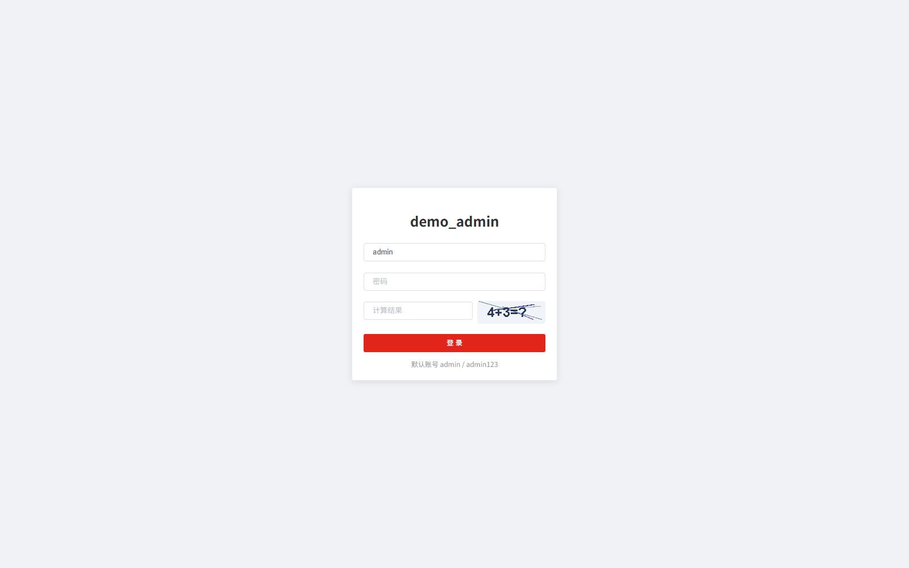
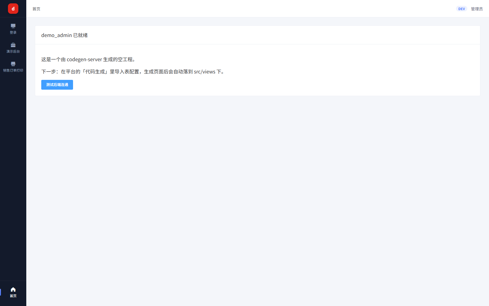
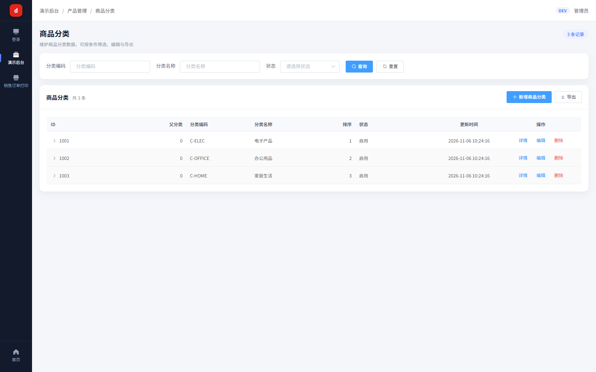
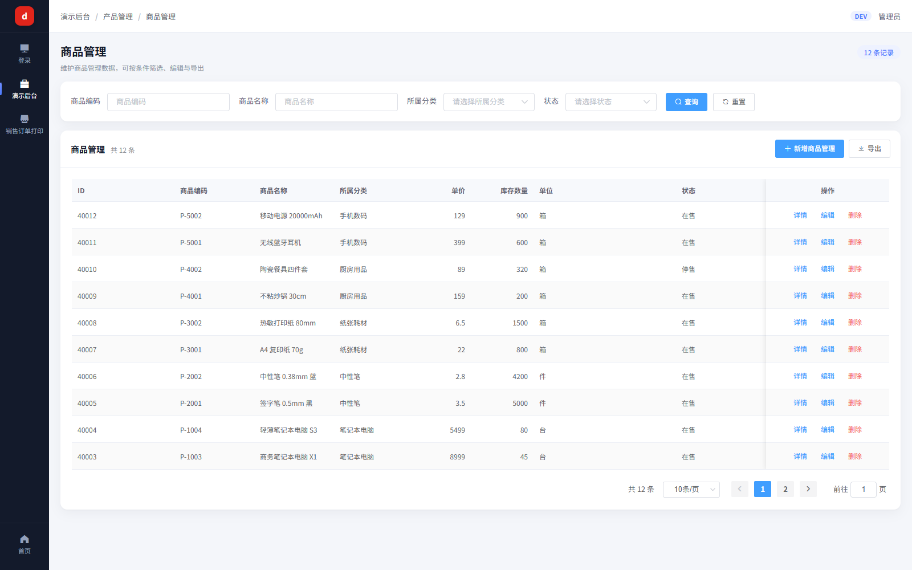
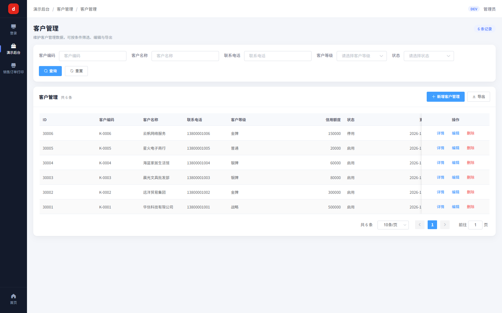
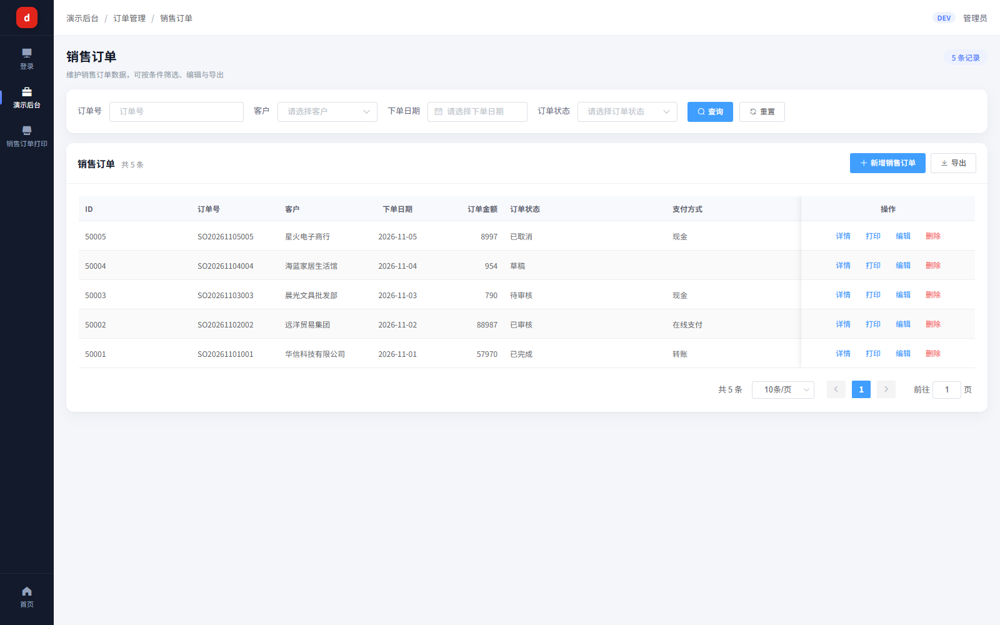
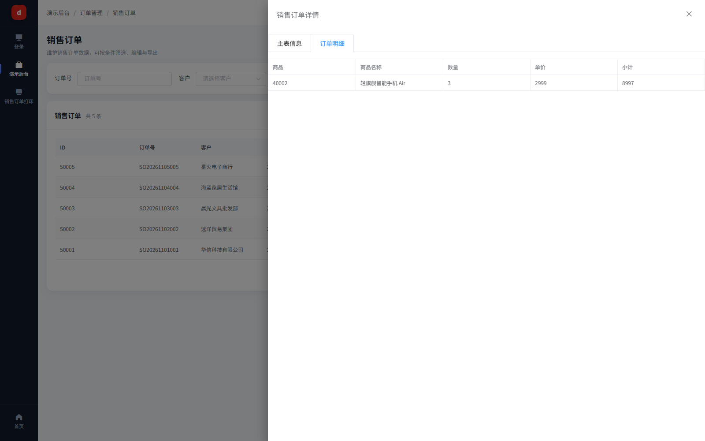
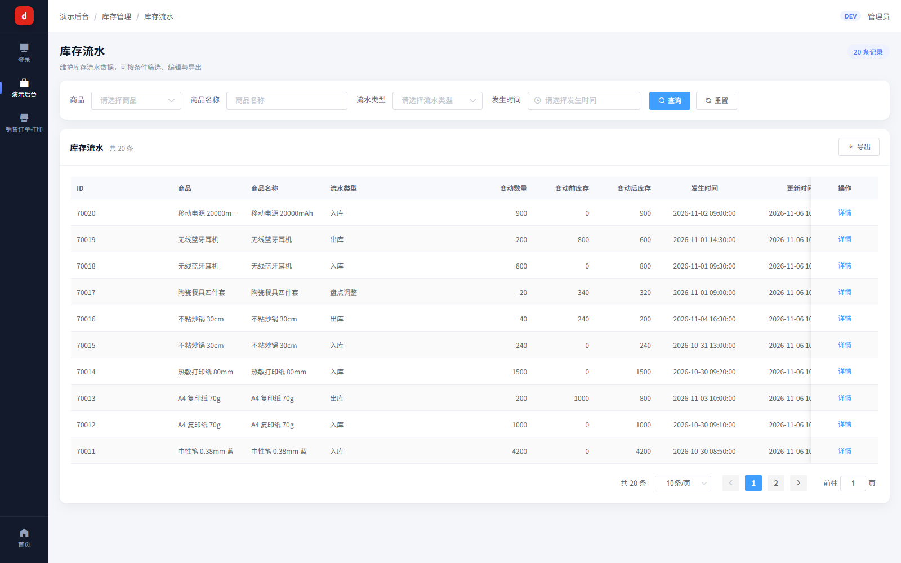
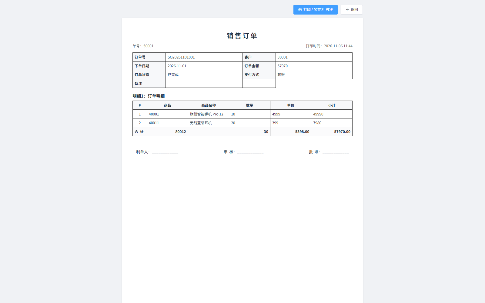

# 典型场景操作指南 · 演示后台 demo

本 demo 是用 **codegen-server「一句话建系统」流水线**自动生成的一套可运行后台，专用于演示《代码生成器操作手册》里的「典型场景」。覆盖 6 张表、5 类典型场景，登录即可点菜单查看真实渲染效果。

> 配套手册：`docs/代码生成器-操作手册.md`  
> 生成器后端：`codegen-server`（8120） ｜ 生成器前端：`codegen-web`（9530）

---

## 0. 如何访问

| 项目       | 地址                      | 说明                 |
| -------- | ----------------------- | ------------------ |
| 演示前端     | <http://localhost:9040> | 登录后点左侧「演示后台」展开业务菜单 |
| 演示后端 API | <http://localhost:8140> | 供前端调用，无需手动访问       |
| 数据库      | `demo_admin`（MySQL）     | 已写入字典、菜单、演示数据      |

**登录账号**：`admin` / `admin123` / 验证码（算术题，看图填写）

> 验证码是生成器默认安全基线。若想临时关闭（仅演示用），后端启动时加参数  
> `--auth.captcha-enabled=false` 即可，无需改代码（开关已实现于 `AuthController`）。

### 效果预览：登录 & 首页

登录页（默认账号 `admin` / `admin123`，验证码为看图算术题）：

登录后首页（左侧图标导航 rail 含「演示后台」入口）：

---

## 1. 树形表 —— 商品分类 `demo_category`

- **菜单路径**：演示后台 → 产品管理 → 商品分类
- **看什么**：层级树（电子产品 > 手机数码 > 智能手机），`parent_id` 自关联，列表按层级缩进展示。
- **生成要点**（平台操作）：
  1. 表配置里勾选                              「树形表」，指定父字段 `parent_id`、名称字段 `category_name`、编码字段 `category_code`；
  2. 一键生成时勾选「树形」开关 → 前端自动渲染树表 + 上级选择下拉。

> 实际渲染（三级层级：电子产品 > 手机数码 > 智能手机，父字段自关联）：

## 2. 标准单表 CRUD —— 客户管理 `demo_customer` / 商品管理 `demo_product`

- **菜单路径**：演示后台 → 客户管理 → 客户管理 ｜ 产品管理 → 商品管理
- **看什么**：
  - 客户管理：增删改查 + 分页 + 字典翻译（客户等级：金牌/银牌/普通）+ 状态（启用/停用）；
  - 商品管理：外键下拉（商品分类，来自 `demo_category`）+ 状态字典 + 唯一校验（商品编码）。
- **生成要点**：默认 17 项生成开关全开即得到完整 CRUD；字段配置里把「客户等级/商品状态」设为字典、把「商品分类」设为外键引用，前端自动出现下拉与翻译。

> 实际渲染（左：商品管理，外键下拉 + 状态字典；右：客户管理，等级字典翻译）：

## 3. 主子表 —— 销售订单 `demo_order` + 订单明细 `demo_order_item`

- **菜单路径**：演示后台 → 订单管理 → 销售订单 → 点任意行「详情」
- **看什么**：主表（订单头：订单号/客户/金额/状态）+ 明细 Tab（订单明细：商品/数量/单价/小计），**同事务保存**；删除主表按配置级联处理明细。
- **生成要点**：表配置选「主从表」，设 `masterTableId = demo_order`、`masterForeignKey = order_id`、关系类型「一对多」；一键生成后前端自动出现「主表 + 明细 Tab」，后端 `saveWithChildren` / `with-children` 接口配套生成。

> 实际渲染（列表页 + 详情抽屉：主表信息 / 订单明细 双 Tab，同事务保存）：

## 4. 只读报表 / 流水 —— 库存流水 `demo_stock_flow`

- **菜单路径**：演示后台 → 库存管理 → 库存流水
- **看什么**：纯列表 + 分页 + 筛选（入库/出库类型、结余），**无新增/编辑/删除按钮**（流水不允许改）。
- **生成要点**：表配置关闭 `genAddBtn / genEditBtn / genDeleteBtn` 三个开关，保留查询与导出即可。

> 实际渲染（纯列表 + 筛选，无增改删按钮）：

## 5. 打印单据 —— 销售订单打印

- **菜单路径**：演示后台 → 销售订单打印（左侧 rail）｜ 或访问 `/print/demo_order/{订单ID}`
- **看什么**：A4 版式打印视图，订单头 + 明细表格，可直接浏览器打印/导出 PDF。
- **生成要点**：表配置勾选「打印」开关，生成器产出 `print.vue` 打印页与对应路由。

> 实际渲染（A4 版式，订单头 + 明细表，可直接打印 / 导出 PDF）：

---

## 6. 进阶场景（平台能力，本 demo 未逐一落表）

| 场景         | 在哪体验                           | 说明                                                                          |
| ---------- | ------------------------------ | --------------------------------------------------------------------------- |
| **结构漂移同步** | 平台：代码生成 → 字段配置 → 同步            | 数据库表结构变更后，一键把新增/删除列同步回生成配置，再重新生成，不丢已有配置                                     |
| **生成回滚**   | 平台：生成台账 → 某批次 → 回滚             | 每次生成/写入都有批次记录，可整批回退到上一个稳定版本                                                 |
| **微服务多模块** | 另见 `wms_warehouse-cloud`（V8.0） | 同一份表配置可生成 Spring Cloud Alibaba 多服务（Gateway + Nacos + OpenFeign），本 demo 为单体版 |

---

## 7. 这套 demo 是怎么生成的（复现步骤）

1. **建系统**：在 codegen-web 新建系统 `demo_admin`，后端根 `D:/workspace/codegen-demo-target`，前端根同；
2. **导入表**：执行 6 张表 DDL（`target/demo-admin/ddl.sql`）后，用「批量接管」把表接进生成器；
3. **配字段**：
   - `demo_category` → 树形；
   - `demo_order` ↔ `demo_order_item` → 主从表；
   - `demo_customer.等级` / `demo_product.状态` → 字典；`demo_product.分类` → 外键引用 `demo_category`；
   - `demo_stock_flow` → 关掉增改删按钮；
   - `demo_order` → 开「打印」；
4. **一键生成 / 流水线**：选「后端 + 前端 + 建库 + 菜单」，流水线跑完即得到可运行工程；
5. **写种子数据**：`dict.sql`（字典）、`init_menu.sql`（菜单）、`demo-data.sql`（演示数据）灌入 `demo_admin` 库。

> 全部脚本见 `codegen-server/target/demo-admin/`：`ddl.sql`、`create.py`、`configure.py`、`demo-data.sql`、`run.py`（流水线驱动）、`smoke.js` / `router-push.js`（无头浏览器自测）。

---

## 8. 自测结论（无头浏览器实跑）

| 页面    | 渲染      | 数据                     |
| ----- | ------- | ---------------------- |
| 商品分类  | ✅ 树表    | 3 级层级（电子产品/手机数码/智能手机…） |
| 客户管理  | ✅ 列表    | 6 条，含字典翻译与状态           |
| 库存流水  | ✅ 只读列表  | 20 条流水，无增改删按钮          |
| 销售订单  | ✅ 主子表列表 | 5 条，详情抽屉展开明细           |
| 登录    | ✅       | admin/admin123 + 算术验证码 |
| 控制台报错 | ✅ 无     | `CONSOLE_ERRORS: none` |

> 截图说明：上述 9 张图（`docs/images/demo/*.png`）由无头浏览器实跑登录 + 逐页渲染所得，全程零报错。  
> 期间修复了一处真实缺陷：字典只读接口 `GET /system/dict/data/type/{code}` 原本直接返回裸数组，与全局响应拦截器约定的 `{code,data,msg}` 包装不一致，导致每个列表页都弹「请求失败」且字典翻译为空；已改为 `Result.ok(list)` 统一包装（见 `demo_admin-server/.../system/SysDictController.java`），修复后菜单/字典翻译与状态列均正常。
